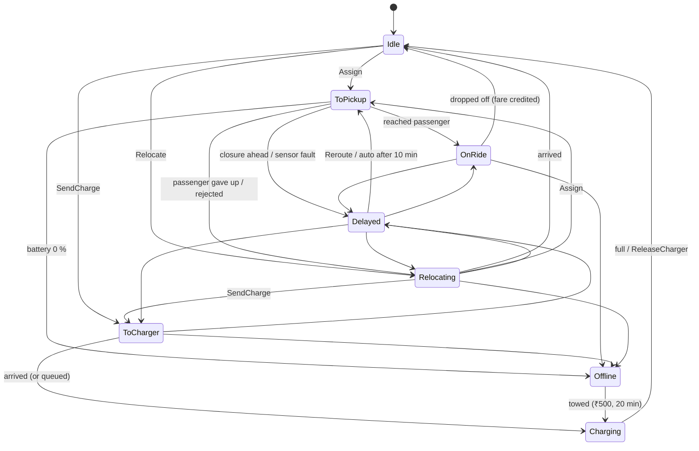
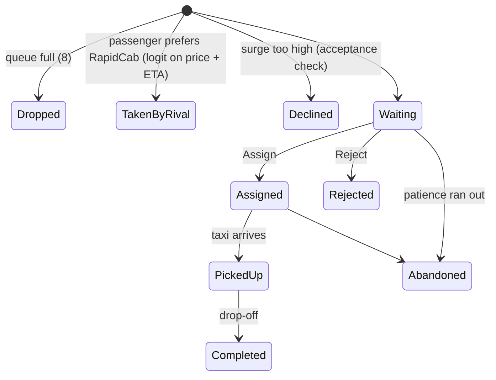

# 02 — Simulation architecture (D2)

The simulation is the heart of the project (spec §4, §18, §29). It is **pure C#** in `Scripts/Core/Sim/` (assembly `TaxiSim.Core`, no UnityEngine), so the same code runs in Unity, in the xUnit tests (`dotnet test sim-tests`) and when a save file is replayed.

## 1. Game loop

```
           ┌────────────── player (ESP32 console / keyboard / HUD) ──────────────┐
           │  Assign · Reject · SendCharge · Reroute · Relocate · ReleaseCharger · SetSurge
           ▼
   Simulation.Submit(Command)  ──►  applied immediately, logged with its tick (CommandLog)
           │
   Simulation.Step()   (1 tick = 15 sim-seconds, 06:00 → 22:00 = 3,840 ticks)
     1. UpdateEvents()      random + scripted events start / end
     2. UpdateTraffic()     rush-hour multipliers × event effects; closures set Edge.Blocked
     3. RivalPricing()      every sim-hour RapidCab best-responds to the player's surge
     4. GenerateRequests()  demand model → passenger chooses provider and checks the price
     5. UpdateRequests()    waiting time; passengers give up after their patience
     6. UpdateTaxi() ×10    move along routes, energy, arrivals, charging, towing, delays
     7. Tick++ → lose checks (cash < −₹2,000, satisfaction < 20) → shift end at 22:00
```

Unity only *reads* the state (taxi node / edge / progress, requests, messages) and draws it. Pausing means not calling `Step()`. At 1× one sim-minute takes 3 real seconds (1.33 ticks per second), so a shift lasts 48 minutes; 2×, 4× and 8× are available. A whole shift simulates in about 0.1 s.

## 2. Entities

| Class | Holds |
|---|---|
| `Taxi` | State, battery %, current node, route (edges + nodes), index of the road it's on, progress along it, assigned request, charger, delay timer, odometer, earnings |
| `RideRequest` | Origin, destination, urgency (Normal / Priority / Medical), fare, locked surge, patience, waited, status, taxi, pickup / drop ticks, free-flow and quoted minutes |
| `TrafficEvent` | Type, road / node / taxi, start and end tick |
| `Command` | Type, two arguments and the tick it was applied (`"412 Assign 3 17"` in a save file) |
| `SimMessage` | Ticker line (Info / Request / Event / Warning / Money / GameOver), which also drives the console's buzzer and LEDs |
| `ScoreCard` | Profit, satisfaction, efficiency, score 0–1, 1–5 stars, outcome |

## 3. Taxi state machine (spec §11 + RELOCATING), enforced by `TaxiStateMachine`



Any other change is refused (test T06).

## 4. Request lifecycle



## 5. Determinism, saves and replay

- All randomness comes from one seeded `Pcg32`, with no other random sources. Only lists are iterated (never dictionaries), and ties are broken by id.
- `StateHash()` is an FNV-1a hash of the tick, the RNG state, money, satisfaction, surge levels, every taxi and every request.
- **Save file** (`SaveGame.Write`): header, seed, difficulty, tick, hash, and one `cmd=` line per command.
- **Load** replays the commands on a fresh simulation and must reproduce the hash exactly, otherwise it throws. That proves the replay (T14) and doubles as a regression test (T18).
- The golden hash test fixes the outcome of a whole autopilot shift (seed 42) under .NET 8. Unity's Mono runtime may differ in the last bit of `Math.Exp`, so save files are portable between machines running the same build.

## 6. Connecting to Unity (built in v0.11 — see docs/04 for the class map)

`SimulationDriver` (World) creates the `Simulation`, calls `Step()` at the chosen speed and maps each taxi to a 3D vehicle (implemented as described; the Ganpati procession and flooding stay cosmetic world features, while sim rain switches the monsoon weather):
- the position comes from `RoadPath.Sample(progress × length)` on its current road;
- fleet taxis leave the AT Fleet Hub gate along the guide line.

Other pieces:
- **Requests** become pulsing Holo pins.
- **Events** link up: a `Festival` event triggers the Ganpati procession, `Rain` drives the monsoon weather and flooding, and `RoadClosure` shows the hazard stripes.
- **Traffic:** `CityPulse` stops inventing traffic and copies the simulation's edge multipliers.
- **HUD:** reads `Requests`, `Taxis`, `Rank()`, `Log` and `Score()`.
- **Console:** `ConsoleBridge` turns button presses into `Submit(Command…)`.
