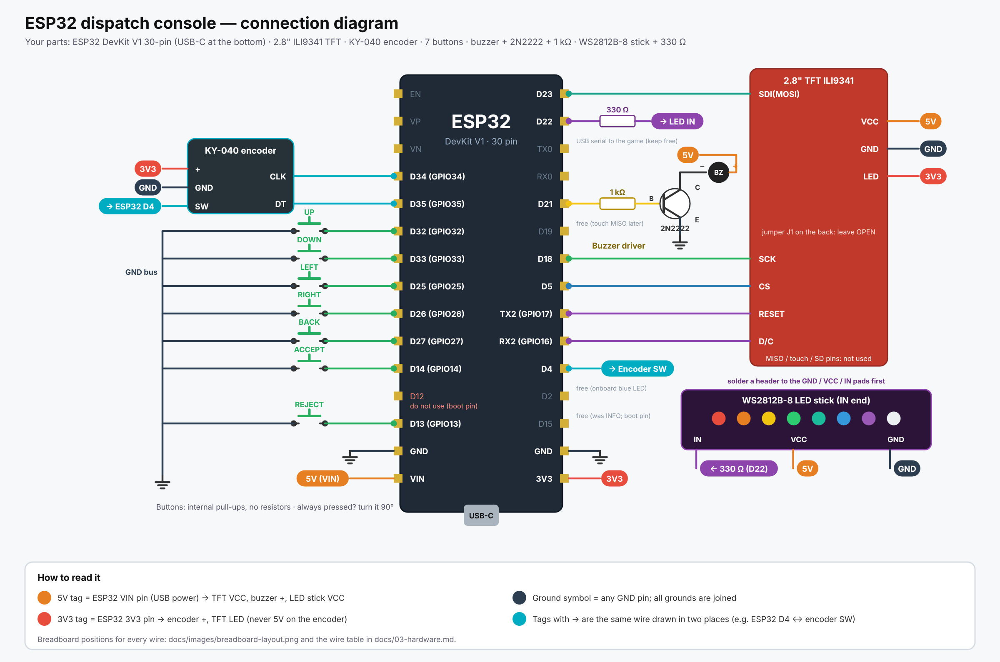
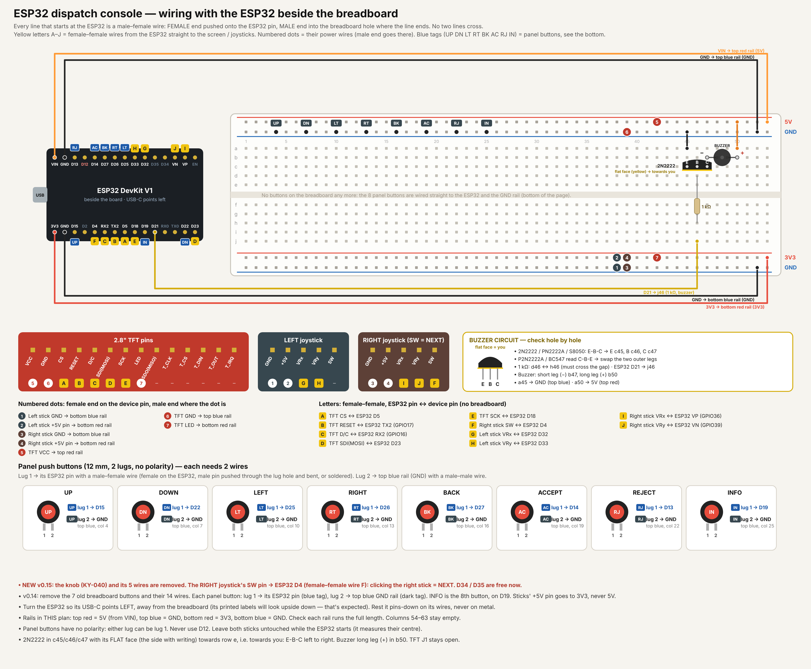

# 03 — Hardware: the ESP32 dispatch console (D3), built from the team's real parts

> **v0.15 (2026-11-25): the knob is removed (firmware v0.7).**
> - Take off the KY-040 and its 5 wires (+, GND, CLK → D34, DT → D35, SW → D4).
> - The **right joystick's SW pin → D4** (female–female, wire F). Clicking the right stick is **NEXT**: it does what one knob step did.
> - D34 and D35 are now free. The checker verifies 40 wires with no shorts.
>
> **v0.14 (2026-11-25): 8 panel push buttons (firmware v0.6).**
> - The 7 tactile switches come off the breadboard. There are now 8 round 12 mm panel buttons with 2 lugs and no polarity:
>   - **lug 1** → the button's ESP32 pin, with a male–female wire (male pin through the lug hole, bent over, or soldered);
>   - **lug 2** → the top blue GND rail, with a male–male wire.
> - Pins: UP D15 · DOWN D22 · LEFT D25 · RIGHT D26 · BACK D27 · ACCEPT D14 · REJECT D13 · **INFO D19** (new).
> - D19 is free because the firmware starts the screen's SPI bus without MISO.
> - The layout below shows every button with its tag. The checker verifies 44 wires, and catches a button wired to a power rail.
>
> **v0.13 (2026-11-25): two joysticks added (firmware v0.5).**
> - The breadboard layout below is updated.
> - Changes from the earlier wiring:
>   - the **UP** wire's female end moves from D32 to **D15**, and **DOWN**'s from D33 to **D22** (their breadboard ends stay in a3 / a8);
>   - the D22 → j43 LED-stick wire and the 330 Ω come out.
> - New wires, joysticks **I–L**:
>   - left stick VRx → D32, VRy → D33;
>   - right stick VRx → VP, VRy → VN.
> - Joystick power, **dots 1–4**: each stick's **+5V pin goes to the 3V3 rail**, never 5V, and GND goes to the bottom blue rail.
> - The connection diagram just below still shows the older pins; the breadboard layout and its wire list are current.

**Read the connection diagram first:** what connects to what, with no wires crossing. **Then use the breadboard layout to build it:** exactly which hole each wire goes in.

This layout is generated from a **checked netlist** (`tools/offboard_plan.py`). The checker confirms:
- every wire lands on the right pin;
- every button works whichever way round it is inserted, both pressed and released;
- there are no shorts between 5V, 3V3 and GND, and the boot pin **D12** is never used;
- every pin carries only one wire, and each wire type matches its ends.

To prove the checker works, planted mistakes were each caught: the buzzer + on GND, a button wire in the wrong strip, the encoder on 5V, and a wire on D12 instead of D22.

> **AS BUILT (2026-11-11):** the team wired the **first** v0.10.6 off-board layout, saved as `images/as-built-layout.png`. In that layout the ESP32 is on the right, the rails are **top red = 3V3** and **bottom red = 5V**, and the buttons run REJECT … UP from left to right. Every ESP32 pin does the same job as in the drawing above, and both layouts passed the same checks, so the firmware is identical. **When measuring, use the as-built rail voltages.** The LED stick is not fitted yet (`HAS_LEDS 0`).
>
> **v0.10.6: the ESP32 now sits BESIDE the breadboard.** Your ESP32's two pin rows are 1 inch apart. On your breadboard it covers rows b to j and leaves a free hole on only one side, so the buttons, encoder and 5 V couldn't be connected. Now the breadboard holds only the buttons, the buzzer driver, the 330 Ω and the power rails. **Every wire to the ESP32 has a female end pushed onto its pin.** The screen's and encoder's signal pins go straight to the ESP32 with **female–female** wires.
>
> **v0.10.4:** one button broke, so there are **7 buttons** (INFO removed; LEFT / RIGHT change the screen page) and the **WS2812B-8 LED stick** is wired in.

## 1. What you have (from your photos, `docs/hardware-photos/`)

| Part | Qty | Identified as | Used for |
|---|---|---|---|
| ESP32 board, USB-C | 1 | **ESP32 DevKit V1, 30-pin** (top: D23 … D15, GND, 3V3 · bottom: EN … D13, GND, VIN) | Console brain |
| 2.8" TFT, red board | 1 | **KMRTM28028-SPI, ILI9341 240×320**, with **touch** (XPT2046), SD slot and stylus | Screen (touch optional later) |
| KY-040 rotary encoder | 1 | Pins GND · + · SW · DT · CLK | Select / cycle / surge |
| Tactile push buttons | 7 (one broke) | 4-leg, red caps | UP DOWN LEFT RIGHT BACK ACCEPT REJECT |
| **WS2812B-8 LED stick** | 1 | 8 RGB LEDs. Input end pads **GND · VCC · IN · GND**, output end **GND · VCC · OUT · GND**. No header soldered yet | Taxi-status lights |
| Small black 3-leg parts (TO-92) | 2 | NPN transistors (2N2222 family). **Read the marking.** | 1 drives the buzzer, 1 spare |
| Black round buzzer, 2 legs | 1 | 12 mm buzzer; the longer leg is + | Beeps |
| 14-pin chip | 1 | **MC74HC125AN** (74**HC**125, not AHCT) | Spare. Only a fallback if the LEDs misbehave (see §7) |
| Resistors, "10k" bundle | 5 | brown-black-orange | Spare (extra encoder pull-ups if needed) |
| Resistors, "1k" bundle | 6 | brown-black-red | 1 × buzzer transistor base |
| Resistors, 3rd bundle (orange bands) | 5 | probably **330 Ω** (orange-orange-brown); check with a multimeter | 1 × LED stick data line |
| Full-size breadboard | 1 | 830 points, 4 power rails | Everything |
| Ribbon jumpers | 10 | male → female | The TFT (8 wires) |
| Jumpers | 3 | male → female | The encoder |
| Loose jumpers | ~26 | mixed. From the photo: roughly **18 male–male**, **8 male–female** | Buttons, power, buzzer |

**Not in the photos** (fine for now): the 1000 µF capacitor and the diode. With only 8 LEDs at 25 % brightness the capacitor is a nice-to-have, not a must.

**USB cable:** the board is **USB-C**. You need a **data** cable; many phone charging cables are power-only and the PC won't see the board.

## 2. Wire budget

| Type | Needed | What they're for | You have (estimate) |
|---|---|---|---|
| **Male–female** | **21** | 13 from ESP32 pins to the breadboard, 8 from the screen / encoder / LED power pins to the rails | about 21 (10 ribbon + 3 + ~8 loose): **just enough, no spare** |
| **Female–female** | **8** | Screen CS, RESET, D/C, MOSI, SCK and encoder CLK, DT, SW, straight to the ESP32 | **count yours** |
| **Male–male** | **9** | 7 button → GND links, transistor → GND, buzzer → 5V | about 18 ✅ |

**Count your female–female wires.** If you have fewer than 8, or if any male–female wire turns out to be male–male, buy a **mixed jumper pack (40 M-M + 40 M-F + 40 F-F, about ₹150–200)**. Spare wires also make fault-finding easier.

The 10-wire rainbow ribbon peels apart into single wires. Peel off what you need.

## 3. Check four parts before wiring (2 minutes)

1. **Transistor pins.** Read the flat face.
   - **2N2222A / PN2222A:** legs **E-B-C** from left to right (flat face towards you, legs down). That's what the drawing assumes.
   - **P2N2222A:** the order is **C-B-E**. Swap which outer leg goes in column 42 and which in column 44.
   - Unsure? Use a multimeter in diode mode: the base is the leg that reads about 0.6–0.7 V to both other legs.
2. **Buzzer.** Briefly touch its legs to **5V and GND** (long leg to 5V).
   - A continuous beep means it's **active**.
   - Only a click means it's **passive**.

   Both work with our firmware. Passive gives proper tones; active beeps at its own pitch.
3. **TFT jumper J1** (next to U1, on the back): it must stay **open** (not soldered). We feed VCC with 5 V and the board's own regulator makes 3.3 V.
4. **Breadboard rails:** on many full-size boards, each rail has a **break in the middle**. Check with a multimeter. If they're split, bridge each of the 4 rails across the break with a short wire.

## 4. Build it in stages, testing as you go

Do every step with the **USB unplugged**. Hole names match the drawing: **row a at the top, column 1 at the left**. Columns 54–63 stay empty.

**The rails in this plan** (different from earlier versions):

| Rail | Carries |
|---|---|
| Top red | **5V** (from VIN) |
| Top blue | GND |
| Bottom red | **3V3** |
| Bottom blue | GND |

**Stage 0: place the ESP32 beside the board**
1. Pull the ESP32 out of the breadboard, rocking it gently so no pin bends. Take the buttons out too.
2. Lay the ESP32 to the **left** of the breadboard, pins down, on paper or cardboard, with **USB-C pointing left** (away from the board). Its printed labels will look upside down; that's expected. Seen from above, the **VIN … EN** pins are now along its top edge, nearest the top of the breadboard, and the **3V3 … D23** pins along its bottom edge.
3. For each wire, push the **female end fully onto the ESP32 pin**. With a few wires on, the ESP32 stands on them. Tape the USB end down lightly so it doesn't tip. Never let it rest on metal.

**Stage 1: power** (4 wires from the ESP32)
1. **VIN → top red rail** (col 53), **GND (next to VIN) → top blue rail** (col 52), **3V3 → bottom red rail** (col 53), **GND (next to 3V3) → bottom blue rail** (col 52).
2. Plug in USB-C. The red power LED on the ESP32 lights up.
3. Use a multimeter to check: top red ≈ **5 V** (4.7–5.1 V is fine), bottom red ≈ **3.3 V**. Check each rail **at both ends**. If a rail is broken in the middle, bridge it with a short male–male wire.
4. Upload the self-test (§5). The Serial Monitor (115200) shows `H,TAXI-CONSOLE,0.2-selftest`, then `K` every second.

**Stage 2: buttons** (7 wires from the ESP32, 7 short male–male links)
1. Put each button **across the centre gap**: two legs in row **e**, two in row **f**. From left to right: **UP** columns 3–5, **DOWN** 8–10, **LEFT** 13–15, **RIGHT** 18–20, **BACK** 23–25, **ACCEPT** 28–30, **REJECT** 33–35.
2. ESP32 → **row a, left column** of each button: **D32 → a3, D33 → a8, D25 → a13, D26 → a18, D27 → a23, D14 → a28, D13 → a33**.
3. Male–male from **row j, right column** of each button → **bottom blue rail (GND)**: j5, j10, j15, j20, j25, j30 and j35.
4. Test: each press prints `B,UP,P` and each release prints `B,UP,R` (likewise for the other buttons). Because the diagonal legs are wired, the buttons work whichever way round they sit.

**Stage 3: rotary encoder** (dots 4–5, letters F G H)
1. Male–female (female ends on the encoder): **+ → bottom red rail (3V3, never 5V)** and **GND → top blue rail**.
2. Female–female: **CLK ↔ D34 (F)**, **DT ↔ D35 (G)** and **SW ↔ D4 (H)**.
3. Test: turning prints `E,+1` / `E,-1`, and pressing the knob prints `B,KNOB,P`.

**Stage 4: screen** (dots 6–8, letters A–E)
1. Male–female (female ends on the screen): **VCC → top red rail (5V)**, **GND → top blue rail** and **LED → bottom red rail (3V3)**.
2. Female–female: **CS ↔ D5 (A)**, **RESET ↔ TX2 (B)**, **D/C ↔ RX2 (C)**, **SDI(MOSI) ↔ D23 (D)** and **SCK ↔ D18 (E)**.
3. Don't connect SDO(MISO), the T_ touch pins or the SD pins.
4. Test: the screen shows **TAXI CONSOLE SELF-TEST** with a box for each button that lights up when you press it.

**Stage 5: buzzer** (1 wire from the ESP32, 2 male–male links)
1. Put the transistor in **c45 / c46 / c47**, with **E** in c45, **B** in c46 and **C** in c47. Its flat face points **down**, towards row e.
2. Put the **1 kΩ** from **d46** across the gap to **h46**.
3. Put the buzzer **−** (short leg) in **b47** and **+** (long leg) in **b50**.
4. Wire **ESP32 D21 → j46**. Add male–male links **a45 → top blue rail (GND)** and **a50 → top red rail (5V)**.
5. Test: a start-up chirp, a beep on every press, and a chime when the screen shows **ALL INPUTS OK**.

**Stage 6: LED stick** (1 wire from the ESP32, dots 1–3)
1. **Solder first.** Solder a 4-pin male header to the **input-end** pads (**GND · VCC · IN · GND**). Never use the OUT end.
2. Lay the **330 Ω** flat in row **g**, from **g39** to **g43**.
3. Wire **ESP32 D22 → j43**. With female ends on the stick: **IN → i39**, **VCC → top red rail (5V)**, **GND → top blue rail**.
4. Test: at power-on the LEDs sweep **red → green → blue → white**. After that, one LED follows the knob.

## 5. Uploading the self-test firmware

1. Install **Arduino IDE 2**.
2. Go to **File → Preferences → Additional boards URL** and add `https://espressif.github.io/arduino-esp32/package_esp32_index.json`, then use **Boards Manager** to install **esp32 by Espressif**.
3. In **Library Manager**, install **Adafruit GFX Library**, **Adafruit ILI9341** and **Adafruit NeoPixel**.
4. Plug in the board and check **Device Manager → Ports** for a new COM port. If none appears:
   - The cable is power-only; try another one.
   - Or the driver is missing: install the **CH340** driver, or **CP210x** if the small chip near the USB says CP2102.
5. Open `firmware/wokwi/sketch.ino`, choose the board **"ESP32 Dev Module"** and the right COM port, then click **Upload**.
   - If it stalls at "Connecting…", hold the **BOOT** button until the upload starts.
6. Open **Tools → Serial Monitor** at **115200** baud.

**Try the simulation first:** at **wokwi.com**, go to **New project → ESP32** and paste `sketch.ino`, `diagram.json` and `libraries.txt` into the tabs of the same names, then press ▶. That diagram uses the same 30-pin board and the same pin connections as your build.

## 6. Full wire list (38 wires, checked)

This table is generated from the same checked plan as the drawing.
- Rows marked **line** are the 13 coloured lines from the ESP32 on the drawing: the female end goes on the ESP32 pin, the male end in the hole.
- **Numbered dots 1–8** are the screen, encoder and LED-stick wires.
- **Letters A–H** are female–female wires.

| # | Wire | Female end on | Other end | Type |
|---|---|---|---|---|
| line | ESP32 VIN → top red rail (5V) | ESP32 VIN | top red rail (5V) | M-F |
| line | ESP32 GND (next to VIN) → top blue rail (GND) | ESP32 GND (VIN side) | top blue rail (GND) | M-F |
| line | ESP32 D13 → a33 (REJECT button) | ESP32 D13 | a33 | M-F |
| line | ESP32 D14 → a28 (ACCEPT button) | ESP32 D14 | a28 | M-F |
| line | ESP32 D27 → a23 (BACK button) | ESP32 D27 | a23 | M-F |
| line | ESP32 D26 → a18 (RIGHT button) | ESP32 D26 | a18 | M-F |
| line | ESP32 D25 → a13 (LEFT button) | ESP32 D25 | a13 | M-F |
| line | ESP32 D33 → a8 (DOWN button) | ESP32 D33 | a8 | M-F |
| line | ESP32 D32 → a3 (UP button) | ESP32 D32 | a3 | M-F |
| line | ESP32 3V3 → bottom red rail (3V3) | ESP32 3V3 | bottom red rail (3V3) | M-F |
| line | ESP32 GND (next to 3V3) → bottom blue rail (GND) | ESP32 GND (3V3 side) | bottom blue rail (GND) | M-F |
| line | ESP32 D21 → j46 (1 kΩ, buzzer) | ESP32 D21 | j46 | M-F |
| line | ESP32 D22 → j43 (330 Ω, LED stick) | ESP32 D22 | j43 | M-F |
| dot 1 | LED stick IN → i39 (after the 330 Ω) | LED stick IN | i39 | M-F |
| dot 2 | LED stick VCC → top red rail (5V) | LED stick VCC | top red rail (5V) | M-F |
| dot 3 | LED stick GND → top blue rail (GND) | LED stick GND | top blue rail (GND) | M-F |
| dot 4 | Encoder + → bottom red rail (3V3, NOT 5V) | Encoder + | bottom red rail (3V3) | M-F |
| dot 5 | Encoder GND → top blue rail (GND) | Encoder GND | top blue rail (GND) | M-F |
| dot 6 | TFT VCC → top red rail (5V; J1 stays open) | TFT VCC | top red rail (5V) | M-F |
| dot 7 | TFT GND → top blue rail (GND) | TFT GND | top blue rail (GND) | M-F |
| dot 8 | TFT LED → bottom red rail (3V3) | TFT LED | bottom red rail (3V3) | M-F |
| A | TFT CS ↔ ESP32 D5 | TFT CS | ESP32 D5 (also female) | F-F |
| B | TFT RESET ↔ ESP32 TX2 (GPIO17) | TFT RESET | ESP32 TX2 (also female) | F-F |
| C | TFT D/C ↔ ESP32 RX2 (GPIO16) | TFT D/C | ESP32 RX2 (also female) | F-F |
| D | TFT SDI(MOSI) ↔ ESP32 D23 | TFT SDI(MOSI) | ESP32 D23 (also female) | F-F |
| E | TFT SCK ↔ ESP32 D18 | TFT SCK | ESP32 D18 (also female) | F-F |
| F | Encoder CLK ↔ ESP32 D34 | Encoder CLK | ESP32 D34 (also female) | F-F |
| G | Encoder DT ↔ ESP32 D35 | Encoder DT | ESP32 D35 (also female) | F-F |
| H | Encoder SW ↔ ESP32 D4 | Encoder SW | ESP32 D4 (also female) | F-F |
| – | UP: j5 → bottom blue rail (GND) | (male) j5 | bottom blue rail (GND) | M-M |
| – | DOWN: j10 → bottom blue rail (GND) | (male) j10 | bottom blue rail (GND) | M-M |
| – | LEFT: j15 → bottom blue rail (GND) | (male) j15 | bottom blue rail (GND) | M-M |
| – | RIGHT: j20 → bottom blue rail (GND) | (male) j20 | bottom blue rail (GND) | M-M |
| – | BACK: j25 → bottom blue rail (GND) | (male) j25 | bottom blue rail (GND) | M-M |
| – | ACCEPT: j30 → bottom blue rail (GND) | (male) j30 | bottom blue rail (GND) | M-M |
| – | REJECT: j35 → bottom blue rail (GND) | (male) j35 | bottom blue rail (GND) | M-M |
| – | Transistor emitter strip a45 → top blue rail (GND) | (male) a45 | top blue rail (GND) | M-M |
| – | Buzzer + strip a50 → top red rail (5V) | (male) a50 | top red rail (5V) | M-M |

**Parts on the board:**
- **Buttons** straddle the gap (rows e / f): **UP** 3–5, **DOWN** 8–10, **LEFT** 13–15, **RIGHT** 18–20, **BACK** 23–25, **ACCEPT** 28–30, **REJECT** 33–35.
- **2N2222** at c45 / c46 / c47 (E / B / C).
- **1 kΩ** from d46 to h46.
- **Buzzer** − at b47 and + at b50.
- **330 Ω** from g39 to g43.
- **The ESP32 sits to the left of the board**, not on it.

## 7. LED stick: why it's wired straight, and what to do if it flickers
The stick is wired **GPIO22 → 330 Ω → IN**, powered from **5V**. The 330 Ω protects the first LED and damps ringing on the data wire.

Strictly, a WS2812B on 5 V wants a data "high" of at least 3.5 V, and the ESP32 gives 3.3 V. In practice this almost always works with a short data wire (keep the IN wire under ~20 cm). If the LEDs **flicker, show wrong colours or only the first one works**, try these in order:
1. **Shorter data wire**, and add the 1000 µF capacitor across the stick's VCC/GND if you have one.
2. **Power the stick from 3.3V instead:** move the stick's VCC wire from the bottom 5V rail to the **top 3V3 rail**. Now 3.3 V data is well above its threshold. The LEDs are a little dimmer and blue/white may look warmer, which is fine at our 25 % brightness (about 120 mA worst case, within the ESP32's 3.3 V regulator).
3. **Use the 74HC125 as a buffer:** GPIO22 → 74HC125 **1A (pin 2)**; **1Y (pin 3) → 330 Ω → IN**; chip **VCC (pin 14) → 5V**, **GND (pin 7)** and **1OE (pin 1) → GND**; unused inputs **(pins 5, 9, 12) → GND** and their OE pins **(4, 10, 13) → 5V**. Note that yours is the **HC** version, which has the same 3.5 V input rule, so this is the least likely of the three to help. The AHCT version would be the proper fix.

## 8. Power and safety
- Everything runs from the laptop's USB: about **300–400 mA**, plus at most **~120 mA** for the LED stick at the firmware's 25 % brightness (never raise `LED_BRIGHTNESS` above ~100 on USB power).
- **3.3 V only** (the bottom red rail in this plan) goes to the encoder's + and the TFT LED pin. **5 V** goes to the TFT VCC (through its own regulator), the buzzer (through the transistor) and the LED stick VCC.
- **Never** connect anything to **D12**. Don't hold **BOOT** while plugging in. D15 is now unused; leave it free.
- Before the first power-on: with a multimeter in continuity mode, there must be **no beep between 5V and GND, or between 3V3 and GND**.

## 9. Serial protocol (USB, 115200 baud, one ASCII line per message)
**Console → game** (comma separated):
- `H,TAXI-CONSOLE,<ver>`: hello at start-up.
- `B,<button>,P|L|R`: press, long press (600 ms), release. Buttons: UP DOWN LEFT RIGHT BACK ACCEPT REJECT KNOB.
- `E,<±n>`: encoder steps.
- `K`: keep-alive, every second.

**Game → console** ('|' separated; firmware v0.4 draws these; plain ASCII, ≤ 64 characters):

| Line | Meaning |
|---|---|
| `S\|clock\|cash\|sat\|surge\|speed` | Header bar (e.g. `S\|09:45\|Rs 4,820\|72%\|x1.25\|2x`) |
| `T\|page\|pages\|title` | Page title and page dots |
| `R\|row\|style\|text` | Row 0–7. Style = colour letter W D G Y O R C B M, plus `*` = selected and `2` = large text |
| `F\|text` | Footer hint |
| `M\|colour\|text` | Toast over the footer for 2.5 s |
| `Z\|cue` | Buzzer pattern: click ok err new urgent event warn coin over start |
| `L\|rrggbb×8` | LED stick colours (ignored while `HAS_LEDS` is 0) |

- The game sends only the lines that changed, about 1.2 KB/s, plus a full refresh every 4 s and after every hello.
- The console switches from its self-test to the game screen on the first game line.
- If the game falls silent for 4 s, the console shows **LINK LOST**.
- Full rules: `Core/Dispatch/ConsoleProtocol.cs` and docs/16-dispatch-game.md.

**Controls with 7 buttons:** UP / DOWN pick a request, the knob cycles candidate taxis, ACCEPT assigns, REJECT declines. **LEFT / RIGHT change the screen page** (Dispatch / Fleet / Finance + Surge / Events), which was INFO's job. **Long-press BACK** pauses. **Long-press the knob** toggles camera mode.

**Firmware v0.4-game** (`firmware/wokwi/sketch.ino`, also `firmware/dispatch_console/src/main.cpp`) contains both the self-test and the game console. Upload it once; it starts in self-test and switches to the game automatically. **Close Arduino's Serial Monitor before pressing Play in Unity**: only one program can use the COM port at a time.
