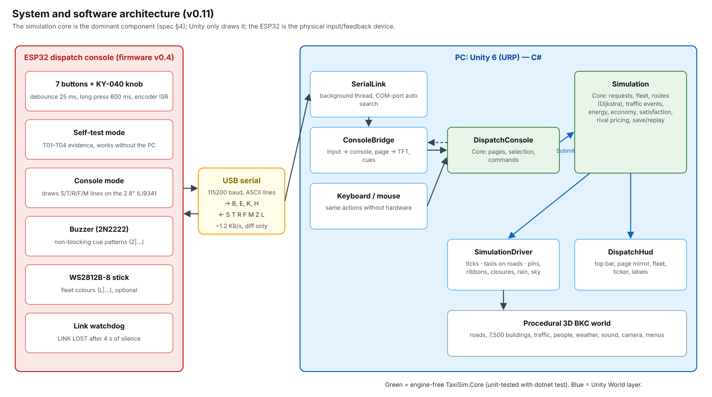

# 04 — Software architecture (D4)



*Figure — the ESP32 is the input/feedback device, the engine-free simulation core is the dominant component, and Unity draws it.*

## 1. Three layers
| Layer | Language / location | Depends on | Tested by |
|---|---|---|---|
| **Simulation core** (`TaxiSim.Core`) | C# 9, `Scripts/Core/**`, assembly with *no* UnityEngine reference | nothing | `dotnet test sim-tests` (69 cases) |
| **Unity presentation** (`TaxiSim.World`) | C#, `Scripts/World/**` | Core + Unity 6 URP | type-check against Unity reference assemblies (`tools/verify`) |
| **Console firmware** | Arduino C++, `firmware/wokwi/sketch.ino` (= `dispatch_console/src/main.cpp`) | Adafruit GFX + ILI9341 (+ NeoPixel) | runs on the PC against the game's real line stream (`tools/verify` step 5) |

Rule: **all game rules live in the core**. Unity and the firmware only read state, draw it and send player commands, so the rules are tested without Unity or hardware.

## 2. Spec §18 modules → our classes
| Spec module | Implementation | Notes |
|---|---|---|
| InputManager | firmware `loop()` (debounce 25 ms, long press 600 ms, encoder ISR) → `SerialLink` → `ConsoleBridge` → `DispatchConsole.Handle` | the keyboard and mouse feed the same `Handle` |
| GameStateManager | `GameMenu` (title, pause, settings), `SimulationDriver` (begin/end shift, pause, speed), `Simulation.Outcome` | |
| CityManager | `BkcMap`, `CityGraph`, `CityGeography` | 23 nodes, 38 roads, zones, chargers |
| RequestManager | `Simulation.GenerateRequests / NewRequest / UpdateRequests`, `RideRequest` | demand by time, zone and events |
| FleetManager | `Simulation.Taxis`, `Taxi`, `TaxiStateMachine` | strict transitions (T06) |
| RouteManager | `RouteFinder.FindFastest` (Dijkstra) | blocked edges skipped, failure with a reason |
| TrafficManager | `Simulation.UpdateTraffic / UpdateEvents`, `TrafficEvent`; world mirror `CityPulse` | 7 event types |
| TripManager | `Simulation.Assign / Advance / Arrive / CompleteTrip` | pickup, travel, drop-off, ETA, lateness |
| EconomyManager | `Simulation.Pay / Cash / Revenue / Costs / Penalties`, `SurgePricing` | fares, charging, tows, fees |
| SatisfactionManager | `Simulation.ChangeSatisfaction`, `Score()` | |
| UIManager | `DispatchHud` (laptop), `DispatchConsole.BuildScreen` + firmware drawing (TFT) | the same page model on both screens |
| FeedbackManager | `DispatchConsole` cues and toasts → `ConsoleBridge` → buzzer (`Z|`), TFT toast (`M|`), LEDs (`L|`); PC beeps without a console | |
| SaveManager | `SaveGame.Write / Load` (seed + command log + state hash) | the menu UI for saves is future work |
| Test/Debug layer | `sim-tests`, `AutoDispatcher` (autopilot), `tools/verify` (type-check, shaders, audio, firmware harness), the bug log | |

## 3. Data flow
**Every frame (Unity `Update`):**
1. `ConsoleBridge` reads the serial lines and keyboard → `DispatchConsole.Handle(input)`. That changes the selection and page, or calls `Simulation.Submit(Command)`, which applies the command immediately and logs it with the tick.
2. `SimulationDriver` adds `deltaTime × speed` to an accumulator and calls `Simulation.Step()` once per 0.75 s at 1×. It then:
   - moves the fleet and RapidCab cars to their simulated positions, interpolated between ticks;
   - updates the pins, ribbons and barriers;
   - sets the sky clock to the simulation clock.
3. `DispatchConsole.PollMessages()` turns new simulation messages into buzzer cues and toasts.
4. `ConsoleBridge` builds the console page and sends only the changed lines to the ESP32, at most 8 times a second.
5. `DispatchHud.OnGUI` draws the laptop panels from the same state.

**Every tick (`Simulation.Step`, 15 sim-seconds):**
1. events start and end;
2. traffic multipliers and closures are updated;
3. RapidCab re-prices (hourly);
4. new requests arrive, and each passenger chooses a provider and accepts or declines the price;
5. waiting passengers may give up;
6. taxis move and use energy, then arrivals, charging and towing are handled;
7. the game-over checks and the end of the shift.

## 4. Communication: USB serial protocol
- **Settings:** 115200 baud, one ASCII line per message.
- **Console → PC:** `B,<BUTTON>,P|L|R`, `E,±n`, `H,TAXI-CONSOLE,ver`, `K`.
- **PC → console:** `S|…` header, `T|…` title, `R|row|style|text` rows, `F|…` footer, `M|…` toast, `Z|cue` buzzer, `L|…` LEDs.
- **Specification:** `Core/Dispatch/ConsoleProtocol.cs` and docs/03 §9.

**Robustness:**
- `SerialLink` runs on a background thread and searches every COM port for a console line.
- DTR and RTS are off, so opening the port doesn't keep the ESP32 in reset.
- The PC drops the link after 3.5 s of silence, and the console shows LINK LOST after 4 s.
- Lines longer than the 128-byte buffer are cut off safely.
- Garbage lines are ignored (tested).

## 5. Determinism and saves
- One seeded PCG32 generator, no other randomness, ordered iteration, ties broken by id.
- A save file is `seed + difficulty + tick + state hash + one line per command`. Loading replays the commands and must reproduce the hash (T14, T18).
- Because console input becomes logged commands, a shift played on the hardware can be replayed exactly. The test `Console_commands_are_logged_so_saves_replay_them` checks this.

## 6. Source tree
```
unity/TaxiManager/Assets/_Project/
  Scripts/Core/City       BkcMap, CityGraph, CityGeography, CityTypes
  Scripts/Core/Routing    RouteFinder (Dijkstra)
  Scripts/Core/Sim        Simulation, Entities, Commands, SimConfig, GameTheory, SaveGame, AutoDispatcher
  Scripts/Core/Dispatch   DispatchConsole, ConsoleProtocol
  Scripts/World/Game      SimulationDriver, DispatchHud, ConsoleBridge, SerialLink
  Scripts/World/...       procedural city builders, traffic, people, weather, audio, camera, UI, menus
  Scripts/Editor          TaxiSimSetup (one-click scene + URP + .NET Framework API level)
  Shaders                 15 custom HLSL shaders (URP)
firmware/wokwi            sketch.ino (+ Wokwi diagram.json), firmware/dispatch_console = PlatformIO copy
sim-tests                 xUnit tests (same .cs files as Unity)
tools                     layout/diagram generators, report figures, verify/ (all offline checks)
```

## 7. Key design decisions
| Decision | Why | Alternative rejected |
|---|---|---|
| Unity 6 URP for the presentation, C# for everything | one language for the core and the world; 3D city with x/y/z camera (team request) | Godot or Pygame (spec suggestion): fine for 2D, weaker for the 3D city |
| Engine-free core | fast tests; deterministic; replayable saves | rules inside MonoBehaviours (untestable) |
| PC renders, ESP32 handles input and feedback | the spec's "simulation dominant, ESP32 secondary" | running the simulation on the ESP32 (too little memory and CPU for 3D) |
| Text-line serial protocol | readable in the Serial Monitor; easy to test | binary packets |
| IMGUI HUD | quick to build, scales with resolution | UI Toolkit (planned earlier; can replace later) |
