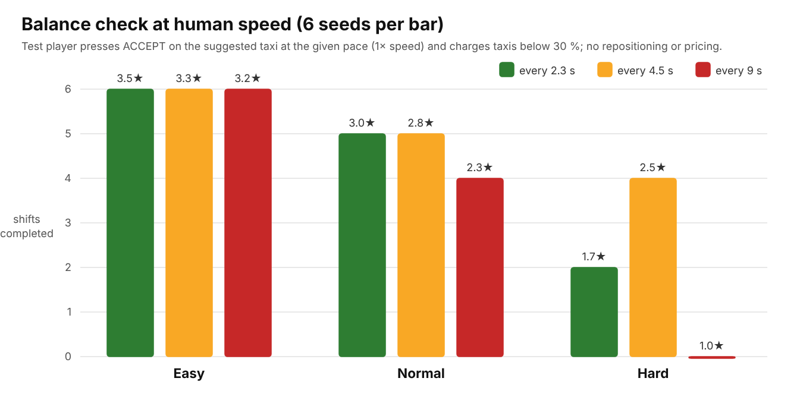

# 07 — Test plan and results (D7)

## How to read this document
- **Status** is one of:
  - **PASS**: evidence is attached;
  - **PARTIAL**: part of the test is evidenced;
  - **TO RECORD**: the procedure is ready, but the team must run it and fill in the result.
- **Automated evidence** comes from `dotnet test sim-tests`: 69 cases, all passing on 2026-11-11 (59 test methods; some run with several inputs).
- The full offline check is `tools/verify/run_checks.sh`. It runs:
  - the tests;
  - the Unity C# type-check (both input systems and the USB-serial path);
  - 148 shader passes;
  - 22 procedural sounds;
  - the firmware run on the PC against the game's real protocol stream, plus the Arduino-IDE prototype check.
- Hardware evidence photos are in `docs/hardware-photos/` and `docs/images/evidence/`.

## 1. Spec test matrix (§24)
| ID | Test | Procedure | Expected | Evidence | Result |
|---|---|---|---|---|---|
| T01 | Power-on | USB-C into the laptop | ESP32 and TFT initialise | Red power LED on; TFT shows the self-test; serial `H,TAXI-CONSOLE,0.4-game` (photos `evidence/console-wired-power-on.jpg`, `evidence/console-selftest-tft.jpg`); harness check "hello line at boot" | **PASS** (2026-11-11) |
| T02 | Button input | Press each of the 7 buttons on the self-test screen | Each box lights, beeps, `B,<name>,P/R` | Self-test reached **ALL INPUTS OK** after bug B013 was fixed; Serial Monitor showed the B lines; harness "ACCEPT press + release reported" | **PASS** |
| T03 | Encoder | Turn both ways, press | The counter changes ±1 per detent; KNOB box; `E,±1` | Self-test photo shows ENCODER and KNOB counts; console tests for the knob's actions | **PASS** |
| T04 | Debounce | Press one button 10 times quickly; hold one for 1 s | Counter +10 exactly; one `P`, one `L`, one `R` | Firmware: 25 ms stable-time debounce, long press 600 ms; harness "long press reports P, L, R" | **PARTIAL**: team to record the 10-press count from the self-test screen |
| T05 | Request generation | Run a shift | Requests appear with origin, destination, fare, urgency and patience; queue ≤ 8 | `New_requests_and_events_become_buzzer_cues`, `T15_QueueNeverExceedsTheLimit`; TFT mock-ups from a real run (`images/fig-tft-pages.png`) | **PASS** |
| T06 | Taxi assignment | ACCEPT on a request | The suggested taxi becomes TO_PICKUP; illegal transitions refused | `T06_StateMachine_AllowsOnlyLegalTransitions`, `T06_TripGoesThroughPickupRideAndBackToIdle`, `Accept_assigns_the_best_taxi_and_reports_ok`; team played the game with the console | **PASS** |
| T07 | Route validity | Route between locations | A valid chain of roads; time/km = the sum over the edges | `T07_RouteIsValidChainOfRoads`, `AllPairs_AreReachable_WhenNoClosures`, `Routing_IsDeterministic` | **PASS** |
| T08 | Blocked road | Close a road on the route and route again | Alternative, or a failure with a reason; taxi delayed → reroute | `T08_BlockedRoad_FindsAlternative`, `T08_IsolatedLocation_ReportsFailure`, `T08_ClosureOnRoute_DelaysTaxi_RerouteAvoidsClosedRoad`, `T08_IgnoredClosure_IsAutoReroutedAfterAWhile`; in-game barriers and ACCEPT-reroute on the Events page | **PASS** |
| T09 | Traffic delay | Trigger heavy traffic | ETA / travel time change | `HeavyTraffic_ChangesTheFastestRoute`; rush-hour multipliers shown on the heat overlay (O key in free-roam) | **PASS** |
| T10 | Fuel | Complete a known-distance trip | Battery falls by 2.5 %/km × traffic factor | `T10_EnergyUseIsProportionalToDistance`, `T10_DispatchIsRefusedWhenChargeIsTooLow` | **PASS** |
| T11 | Charging | Send a taxi to a station | +2 %/min, ₹2 per %, queue when full | `T11_ChargingAddsTwoPercentPerMinuteAndCostsMoney`, `T11_FullChargerQueuesTheNextTaxi`, `Fleet_page_sends_a_taxi_to_charge_and_relocates` | **PASS** |
| T12 | Trip completion | Run a trip to its destination | Fare × surge credited; satisfaction up | `T12_FareTimesSurgeIsCreditedOnCompletion` | **PASS** |
| T13 | Economy | Complete, reject and abandon trips | Income, costs and penalties correct | `T13_AbandonedRequestCostsMoneyAndSatisfaction`, `T13_RejectionLowersSatisfactionButCostsNoMoney`, `Reject_declines_and_costs_satisfaction` | **PASS** |
| T14 | Save/load | Save, then load | Identical state | `T14_SaveThenLoad_ReplaysToTheIdenticalState`, `T14_TamperedSaveIsDetected`, `Console_commands_are_logged_so_saves_replay_them` | **PARTIAL**: the core save/replay is proven; the in-game Save/Load buttons are future work (documented reset: Esc → Main menu → new shift) |
| T15 | Boundary | Zero battery / no taxis / full queue | A defined safe state, no crash | `T15_EmptyBatteryMeansTowFeeThenCharging`, `T15_BusyTaxiCannotBeAssignedAgain`, `T15_QueueNeverExceedsTheLimit`; console with no feasible taxi shows "No taxi can take this one"; firmware ignores bad lines (harness) | **PASS** |
| T16 | Long run | Run 15–20 min | Stable, responsive | `T16_TenFullShifts_RunCleanly_WithSaneInvariants` (10 full simulated shifts); Unity runs at 59 FPS on Ultra (`evidence/city-unity-play.png`) | **PARTIAL**: team to play 20 minutes with the console and note FPS and lag |
| T17 | Playtest | A new student plays without explanation | Controls and goal understood | Form in §4 | **TO RECORD** |
| T18 | Regression | Repeat the suite after changes | Previous functions still correct | `T18_GoldenShiftHash` (whole-shift hash); `run_checks.sh` run after every version; bugs B016–B017 were caught this way | **PASS** |

## 2. Integration and hardware tests (beyond the spec list)
| ID | Test | Evidence | Result |
|---|---|---|---|
| H1 | Wiring netlist (38 wires) has no shorts, every pin right, buttons work either way round | `tools/offboard_plan.py` (automatic check + mutation tests: planted faults are caught) | PASS |
| H2 | Pre-power safety: no red↔blue rail short; components cool after 10 s | Team visual checklist + power-on photo (no multimeter available) | PASS |
| H3 | USB driver and port | CP210x driver installed, COM8 (`evidence/device-manager-cp210x.png`) | PASS (after bug B014) |
| H4 | Console ⇄ game link, end to end | The team played a shift entirely from the console (2026-11-11) | PASS |
| H5 | Protocol robustness | Firmware harness: switches to console mode, draws every page, LINK LOST after 4 s, recovers, ignores garbage, truncates over-long lines, ASan/UBSan clean (12 checks) | PASS |
| H6 | Protocol unit tests | `Parses_button_lines` ×4, `Parses_encoder_hello_and_keepalive`, `Rejects_bad_lines` ×8, `Outgoing_text_is_plain_ascii_without_separators`, `Every_screen_line_fits_the_tft` | PASS |
| H7 | Bandwidth | about 0.7–1.2 KB/s of 11.5 KB/s available; longest line 58 characters of 127 | PASS |
| H8 | Arduino IDE build | Compiles in Arduino IDE 2.3 with esp32 core 3.3.12 (24 % flash, 7 % RAM) after bug B015 | PASS |

## 3. Balance and performance
**Autopilot** (perfect play, 20 seeds per difficulty; docs/06 §5): every preset completes 20/20 shifts with 4.0 stars. With no dispatching at all, the player is fired at about 08:36.

**Human-speed bot** (presses ACCEPT on the suggestion every 2.3, 4.5 or 9 s at 1× and charges below 30 %; 6 seeds each):

| Difficulty | Completed (2.3 / 4.5 / 9 s) | Average stars |
|---|---|---|
| Easy | 6 / 6 / 6 | 3.5 / 3.3 / 3.2 |
| Normal | 5 / 5 / 4 | 3.0 / 2.8 / 2.3 |
| Hard | 2 / 4 / 0 | 1.7 / 2.5 / 1.0 |

**Reading:** Easy forgives a slow player and Normal rewards attention. Hard needs the Fleet and Money pages: charging early, repositioning before the rush and pricing.

**Performance:**
- 59 FPS on the Ultra tier on the team's laptop with the full city (7,516 buildings, 250 vehicles, 400 walkers).
- The first world generation takes 11.7 s.
- One simulated shift computes in about 0.1 s.

## 4. Playtest form (T17), fill one per tester
| Field | Tester 1 | Tester 2 | Tester 3 |
|---|---|---|---|
| Name / course | | | |
| Played games like this before? | | | |
| Explanation given | none (only "you run a taxi fleet") | none | none |
| Time until the first successful dispatch | | | |
| Did they find LEFT/RIGHT pages by themselves? | | | |
| Understood why a taxi was suggested? (1–5) | | | |
| Difficulty felt (1 easy – 5 hard) | | | |
| Fun (1–5) | | | |
| Final stars / outcome | | | |
| Confusing moments (quotes) | | | |
| Change we made because of this | | | |

## 5. Test log
| Date | Version | What was run | Result |
|---|---|---|---|
| 2026-11-05 | v0.9 | 43 unit tests, autopilot balance (60 shifts) | all pass; balance fix B012 |
| 2026-11-10 | v0.10.x | wiring netlist + mutation tests | pass |
| 2026-11-11 | v0.10.10 | hardware self-test on the real console | ALL INPUTS OK after B013 |
| 2026-11-11 | v0.11 | 69 tests, type-checks, firmware harness, human-speed balance | all pass (B016, B017 found and fixed) |
| 2026-11-11 | v0.11.1 | Arduino IDE build, end-to-end play with the console | pass after B015 |
| 2026-11-19 | v0.12.1 | Settings time-of-day fix (B019): Unity type-check (both input systems, serial path, editor) + 69 tests | pass |
| | | *(team: add the playtest and 20-minute run rows)* | |
