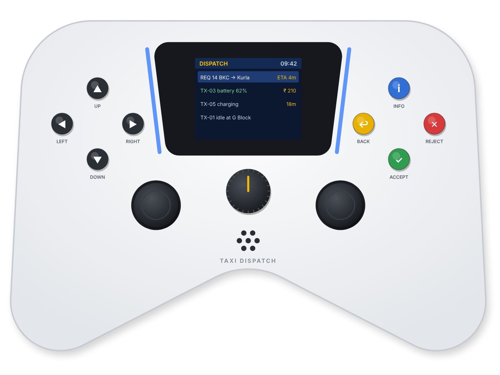
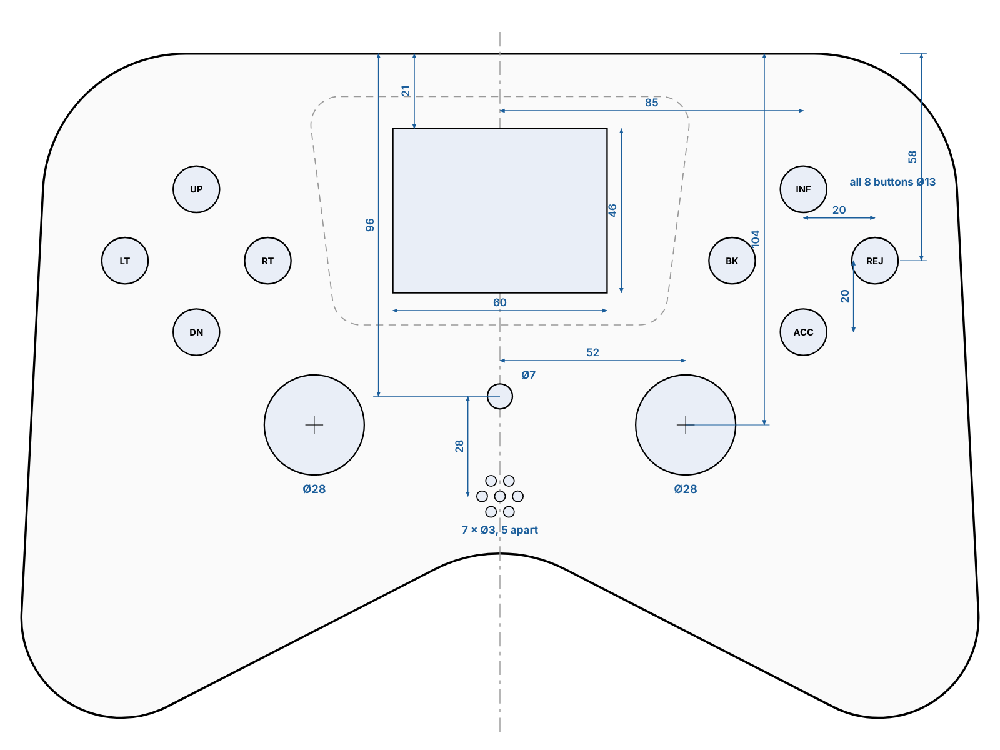
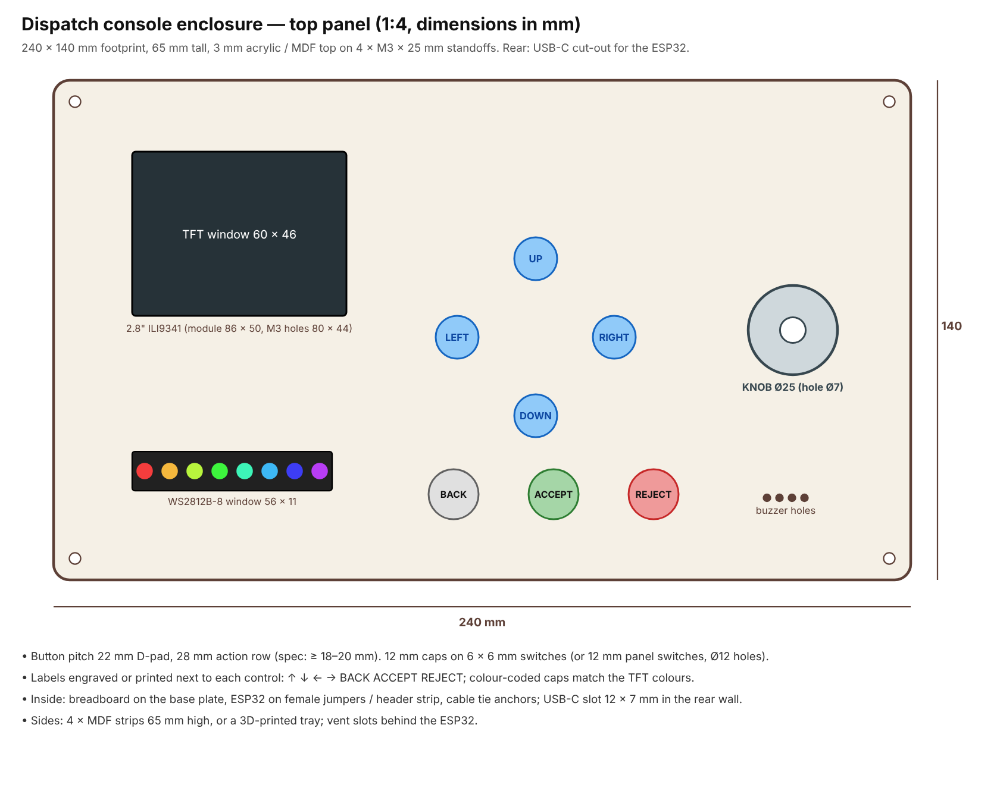

# 10 — Console enclosure

## v2 (current plan, 2026-11-24): cardboard two-grip controller

The team is building the console as a **PS5-style two-grip controller from 3 mm corrugated cardboard**. It replaces the flat MDF box of v1 (kept below for reference).

**Files:**
- `enclosure/controller-templates-1to1.pdf`: 1:1 cutting templates. Page 1 is the lid, page 2 the base, page 3 the small parts. Print on A4 at 100 %; each page has a 100 mm check bar.
- `enclosure/controller-build-guide.pdf` (10 pages): parts, cutting list, outline construction, hole table, inside layout, side section, build steps and the new pin plan.
- `tools/enclosure/` holds the generator: `python3 tools/enclosure/gen.py build && node tools/enclosure/render.js build`.

| Item | Value |
|---|---|
| Size | 268 × 186 × 66 mm (3 lid + 60 wall + 3 base) |
| Outline | 3 circles per side + straight lines. Shoulder C1 (±88, 40) R40, grip C2 (±106, 158) R28, arch C3 (0, 180) R40 (concave). Perimeter 858.9 mm |
| Screen | 60 × 46 window centred at (0, 44); black bezel glued on top |
| Buttons | 8 × Ø13 for 12 × 12 tactile switches with 12 mm caps. Arrows on the left around (−85, 58), INFO / ACCEPT / BACK / REJECT on the right around (85, 58); 20 mm from each cluster centre |
| Joysticks | 2 × KY-023 through Ø28 at (±52, 104), on 34 × 16 fences |
| Knob | KY-040 through Ø7 at (0, 96) |
| Buzzer | 7 × Ø3 grille at (0, 124), buzzer glued underneath |
| Inside | Full-size breadboard on the base at y 62–117; ESP32 upside down at the top wall, USB slot 14 × 10 at the centre |

(x is measured from the centre line, y down from the top edge, in mm.)

**Buttons (v0.14): 12 mm round panel push buttons.**
- They screw straight into the lid with their nut and washer, so the button beds and corner blocks from the build guide are not needed.
- A Ø12 mm hole is the snug fit. The template's Ø13 also works: the washer covers the gap once the nut is tightened.
- Each body hangs about 30 mm under the lid with its lugs, which fits inside the 60 mm wall.
- Diagonal neighbours are 28 mm apart and the collars are about 16 mm wide, so they don't touch.

**v0.15: no knob.** Leave the Ø7 knob hole uncut, or cover it with a small card patch (or use it for the buzzer sound). The right stick's click does the knob's job.

**Pin plan (since firmware v0.6, project v0.14):** UP D15 · DOWN D22 · LEFT D25 · RIGHT D26 · BACK D27 · ACCEPT D14 · REJECT D13 · INFO D19.

**Earlier pin plan (firmware v0.5, project v0.13):**
- UP → D15, DOWN → D22. The other buttons and the knob are unchanged.
- Left stick VRx/VRy → D32/D33; right stick → VP/VN (GPIO36/39). Both sticks are powered from **3V3**. Stick clicks are not wired.
- The LED stick stays out.
- Still free: D19, D2, D12. A future 8th button (INFO) should go on D19.

---

## v1 (original plan): MDF box

## 1. Requirements (spec §6) and our design
| Spec | Value | Our design |
|---|---|---|
| Length | 220–260 mm | **240 mm** |
| Depth | 120–150 mm | **140 mm** |
| Height | 55–70 mm | **65 mm** (breadboard 9 mm + ESP32 on jumpers about 30 mm + clearance) |
| Top panel | 3 mm acrylic / MDF / 3D print | **3 mm MDF** (cheap, easy to drill) or clear acrylic (shows the electronics at the viva) |
| Button spacing | ≥ 18–20 mm | **22 mm** D-pad, **28 mm** action row |
| Encoder knob | 20–30 mm | **25 mm** knob, 7 mm shaft hole |
| Display opening | match the TFT | **60 × 46 mm** window over the 57.6 × 43.2 mm active area; module 86 × 50 mm, mounting holes 80 × 44 mm (M3) — **measure your module before cutting** |
| Rear access | USB + power | **12 × 7 mm USB-C slot** in the rear wall, in line with the ESP32 |

**Layout logic:** the screen is on the left, where your eyes go first. The D-pad is in the middle for the right thumb or index finger. ACCEPT, the most used button, sits in the middle of the action row, with REJECT to its right and BACK to its left. The knob is on the far right, where it is easy to turn. The LED window sits under the screen so status lights are seen together with the page.

## 2. Parts
| Part | Size / qty |
|---|---|
| Top panel | 240 × 140 × 3 mm, 1 |
| Base plate | 240 × 140 × 3 mm, 1 |
| Side walls | 2 × (240 × 65) + 2 × (134 × 65) × 6 mm MDF, glued and pinned (or one 3D-printed tray) |
| Standoffs | 4 × M3 × 25 mm brass, at 6 mm from each corner |
| TFT mount | 4 × M3 × 10 mm standoffs on the underside of the top panel |
| Buttons | 7 × 12 mm panel push buttons wired to the breadboard, or keep the 6 × 6 tactile switches on a small perfboard under the panel with 12 mm caps poking through Ø12.5 mm holes |
| Encoder | KY-040 fixed through a Ø7 mm hole with its nut; 25 mm knob |
| Buzzer | 4 × Ø3 mm sound holes above it |

## 3. Build steps
1. Print the top-panel drawing at 100 % (or send the SVG `docs/images/fig-enclosure.svg` to a laser cutter, after converting it from 1:4 scale). Check the TFT module and button sizes with a ruler first.
2. Cut or drill: the TFT window, 7 button holes, the encoder hole, the LED window, the buzzer holes and 4 corner holes.
3. Mount the TFT under the window on M3 standoffs. Run its ribbon to the breadboard.
4. **Buttons through the panel:** the breadboard buttons are too far below the panel. Either use panel buttons with two wires each (same GPIO/GND as now), or mount the 6 × 6 switches on a perfboard glued under the panel and run their two diagonal legs to the same breadboard holes.
5. Stick the breadboard to the base. Rest the ESP32 on its jumpers next to it, aligned with the rear USB-C slot. Bundle the wires with cable ties.
6. Label each control on the panel (printed sticker or engraving): ↑ ↓ ← → BACK ACCEPT REJECT, plus KNOB.
7. Power-on test: run the self-test screen and press every button through the panel (repeat T01–T04).

## 4. Safety (spec §8)
- USB 5 V only; never mains.
- No exposed metal touching the ESP32 pins (insulated jumper sleeves).
- Ventilation slots behind the ESP32.
- The wiring was checked automatically (docs/03), and the power-on checklist was followed before closing the box.
