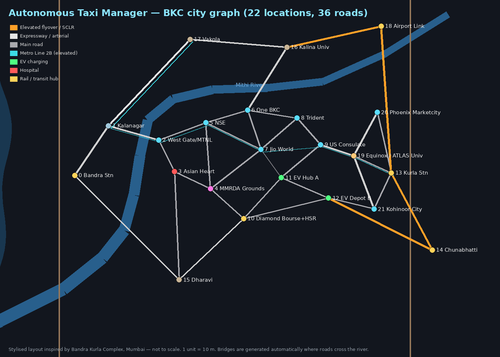

# 11 — 3D World Design: Bandra Kurla Complex (BKC), Mumbai

**Version:** v0.5 (October 2026) · **Engine:** Unity 6 LTS + URP · **Status:** code complete, awaiting the first in-Editor compile.

## 1. Design goals

1. **Recognisably Mumbai.** The world includes:
   - the BKC G-Block glass towers, Jio World Centre and the Fountain of Joy
   - the corridor from BKC through **Equinox Business Park / ATLAS SkillTech University** along LBS Marg to **Kurla Station**, with Phoenix Marketcity and Kohinoor City
   - the Mithi River with its mangroves, Mumbai locals on the Western and Central lines
   - kaali-peeli taxis, auto-rickshaws and red BEST buses
   - the monsoon, the Bandra–Worli Sea Link, and planes landing over Kurla
2. **Every visual is driven by simulation data.** The 3D city is generated from the same `CityMap` that the dispatch simulation uses. Roads are graph edges, junctions are nodes, and flyovers are edges marked `Elevated`. What the player sees is therefore always what the route engine computes.
3. **Ultra-quality look on a student budget.** There are no paid assets and no textures. Everything is procedural geometry plus custom HLSL shaders, which keeps the project small, legal and fully explainable in the viva.
4. **Real 3D movement on all three axes.** The camera pans on x/z and zooms in height on y, the terrain carves the river channel, and the flyovers, metro and bridges sit on real elevation.

## 2. Map: 23 locations, 38 roads (spec §3 asks for 10–15+)

v0.7 added location 23, **AT Fleet Hub** (`fleet_hub`, zone `FleetDepot`, 12 chargers). It is the depot every autonomous taxi launches from, linked by Fleet Hub Road to EV Depot B and to the Diamond Bourse.

Coordinates are in units of 10 m: x points east, z points north, y points up. The layout is stylised and not to scale.

| # | Location | Zone | Gameplay meaning |
|---|---|---|---|
| 0 | Bandra Station (East) | Rail hub | Commuter demand peaks |
| 1 | Kalanagar Junction | Junction | Western Express Highway entry |
| 2 | BKC West Gate / MTNL | Commercial | Telecom tower landmark |
| 3 | Asian Heart Institute | Hospital | Urgent (medical) requests |
| 4 | MMRDA Grounds | Event | Festival / concert demand surges |
| 5 | NSE Exchange Plaza | Financial | Morning office rush |
| 6 | One BKC Towers | Financial | Office demand |
| 7 | Jio World Centre | Commercial | Convention and mall demand |
| 8 | Trident & Sofitel | Hotel | Airport trips |
| 9 | US Consulate / G-Block East | Government | Scheduled visitors |
| 10 | Diamond Bourse + HSR station | Transit hub | Bullet-train arrivals |
| 11 | EV Hub A (Jio World Drive) | Charging (2 bays) | Fast charging |
| 12 | EV Depot B (BKC Bus Depot) | Charging (3 bays) | Charging and depot |
| 13 | Kurla Station (LBS Marg) | Rail hub | Central line demand |
| 14 | Chunabhatti / Eastern Freeway | Transit hub | Reached by the elevated connector |
| 15 | Dharavi T-Junction | Residential | Dense residential demand |
| 16 | Kalina – Mumbai University | Education | Student demand |
| 17 | Vakola / Santacruz East | Residential | Residential demand |
| 18 | SCLR → CSMIA Airport | Airport | Long, high-fare trips |
| 19 | Equinox Business Park / ATLAS SkillTech University | Education | Student and office demand; the hub of the BKC → Kurla corridor |
| 20 | Phoenix Marketcity (LBS Marg) | Commercial | Mall demand, evening and weekend peaks |
| 21 | Kohinoor City / Kurla West | Commercial | Mall and residential demand |

**The BKC → Kurla corridor (v0.3).** The city now runs continuously from G-Block East to Kurla Station:
- **BKC–Kurla Connector Road:** US Consulate → Equinox / ATLAS.
- **LBS Marg:** Phoenix Marketcity → Equinox / ATLAS → Kohinoor City.
- **Station roads:** Equinox, Kohinoor City and Phoenix Marketcity each link to Kurla Station.
- **Kurla Depot Link:** EV Depot B → Kohinoor City.
- **Districts:** six new ones (BKC–Kurla Connector, Equinox / LBS Business Strip, Kurla West (Kapadia Nagar), Kurla West South, the dense Kurla Station Market, Phoenix / LBS North) fill the corridor with buildings.
- **Metro Line 2B** now runs via Equinox to Kurla.

**Elevated roads (the y-axis gameplay):**
- BKC–Chunabhatti Connector
- LBS–SCLR Flyover
- SCLR Elevated
- SCLR Double-Decker

**Automatic bridges over the Mithi River:**
- Kalanagar Bridge
- Mahim–Dharavi Link
- CST Road
- SCLR, which is elevated anyway

Bridges are detected wherever a road crosses ground below water level.

## 3. World generation pipeline (`BkcWorldBootstrap.Awake`)

Order matters, because each step reserves ground in `SpaceRegistry` so that later steps never overlap it.

1. **Terrain** (`TerrainBuilder`). Three ground LOD rings at 2, 8 and 32 unit resolution. The river channel and the sea are carved by `CityGeography.GroundHeight`, and a water surface sits at −0.35 underneath.
2. **Roads** (`RoadNetworkBuilder`). Builds the following:
   - one asphalt ribbon per edge, so each road can have its own overlay
   - junction plazas, bridge decks with ramps, and flyovers on pillars
   - crash barriers and sidewalks
   - street lamps: white LED inside BKC, sodium orange outside
3. **Transit** (`TransitBuilder`). Builds the following:
   - the Western and Central railway lines with 25 kV masts and animated 9-car locals
   - the Metro Line 2B viaduct with 3 stations and a 6-car train
   - the Bandra–Worli Sea Link with an inverted-Y pylon, neon cables and its own traffic
   - the airport runway, terminal and control tower, with an A320-style approach loop
4. **Landmarks** (`LandmarkBuilder`). These include the Equinox towers with ATLAS SkillTech University (orange LED fin, campus lawn), Phoenix Marketcity (LED facade, glass atrium) and Kohinoor City. Each landmark is auto-placed next to its junction and faces the road. Holographic beacons mark every dispatch location: cyan by default, green for charging, red for the hospital and gold for hubs.
5. **Districts** (`CityBlockBuilder`). There are 19 districts and around 1,000 deterministic buildings, aligned to the nearest street:
   - glass CBD towers with podiums, setbacks and cylinders
   - pastel apartments with water tanks
   - dense Dharavi low-rise with blue tarpaulin roofs
   - the campus, and far skylines (Worli/Lower Parel, Powai, Ghatkopar)
5a. **Street clutter** (`StreetClutterBuilder`, v0.10). Builds parked cars half on the kerb, scooter rows, electric poles with tangled cables, black-yellow kerbs, speed breakers, bins, hand carts, stray dogs, cows and glass-tower fins. It runs after the street life and before the trees, and reserves its footpath spots.
5b. **Street life** (`StreetLifeBuilder`, v0.7). Builds the following, and reserves footpath spots so trees avoid them:
   - roadside stalls (carts with umbrellas, fruit stalls under tarps, chai and paan kiosks, bulbs at night, vendors and customers)
   - BEST bus shelters with lit ad panels and waiting commuters
   - pole hoardings on the arterials, rooftop billboards, and wall adverts on mid-rise buildings
   - (in `CityBlockBuilder`) balconies, chhajjas, Sintex tanks, AC units, stair heads and parapets into one chunked "building props" mesh
6. **Nature** (`NatureBuilder`). Avenue trees (rain trees, flame-red gulmohar, coconut palms near the coast), parks, and mangroves along both river banks. All foliage sways in the wind and sways more in the monsoon.
7. **Systems.** These run every frame:
   - `TimeOfDay`: sun, moon, sky, ambient light, fog, probe refresh, lamps, headlights, colour grading
   - `WeatherSystem`: clear, haze or monsoon, with rain particles, wetness, ripples and lightning
   - `PostFxRig`: bloom, ACES tonemapping, grading, vignette, grain, chromatic aberration, tilt-shift
   - `StreetLights`: real point lights, the number set by the graphics tier
   - `TrafficSignals` (v0.7): red, amber and green heads on every approach of each 3+ way junction, with phases of 11 s green, 2.5 s amber and 1 s all-red
   - `TrafficAmbient`: left-hand traffic with car-following, red-light stops, per-driver irregular speeds, lane changes, scooters and trucks; 6 fleet EVs launched from the AT Fleet Hub, 4 RapidCab rivals
   - `PedestrianSystem` (v0.7): 60–400 walkers on the footpaths, animated on the GPU; since v0.8 they wait at signalised corners and cross on the walk phase
   - `CitySoundscape` (v0.8): procedural city sound mixed from the camera's position (see `docs/14-sound-cinematic-video.md`)
   - `CinematicDirector` (v0.8): C, automatic shot-by-shot film mode for the demo video
   - `FloodSystem` (v0.9): monsoon waterlogging on 6 low-lying stretches; vehicles slow down and throw spray
   - `FestivalSystem` (v0.9): Y — Ganpati procession that closes a road, Diwali lights, lanterns and fireworks
   - `MinimapView` (v0.9): K — rasterised live map; `GameMenu` (v0.9): title, pause (Esc) and settings
   - `CityPulse`: rush-hour traffic multipliers and the heat overlay
   - `RouteShowcase`: Dijkstra route demo
   - `CityCameraRig`: camera control
   - `WorldOverlay`: on-screen labels and panels

## 4. Shaders (all custom URP HLSL, SRP Batcher compatible, no textures)

| Shader | Highlights |
|---|---|
| `TaxiSim/CityTower` | Procedural facade grid that blends from curtain-wall glass to punched concrete. **Interior mapping** draws fake 3D rooms behind every window. Rooms switch on and off at night with warm or cool lights. Also: lobby glow, LED crown bands, blinking aviation lights on towers over 90 m, monsoon grime streaks, wet gloss, and blue tarpaulin roofs. Distance anti-aliasing stops the window grid shimmering. |
| `TaxiSim/Road` | Asphalt with grain, repair patches and tyre tracks. Indian road markings: double yellow centre line, dashed lanes, edge lines, zebra crossings. Wet sheen with puddles that ripple in rain. Per-road **traffic heat** glow, plus pulsing hazard stripes on **closed roads**. |
| `TaxiSim/Water` | Vertex waves with analytic normals and two layers of detail noise. Colour goes from shallow to deep using the depth texture, with shoreline foam, Fresnel reflections from the city reflection probe, and rain ripples. |
| `TaxiSim/Surface` | Ground, grass, paving, track bed and sand from the same shader. River banks blend into wet Mithi mud. |
| `TaxiSim/PBR` | Vehicles, foliage and structures. Supports vertex colours, emission that follows the night, blinking, and wind sway. |
| `TaxiSim/Sky` | Gradient sky with a coastal haze band, sun disc and glow, moon, twinkling stars and drifting fBm clouds. |
| `TaxiSim/FlowLine` | HDR animated chevrons for routes. |
| `TaxiSim/Holo` | Fresnel holograms with scanlines for beacons. |
| `TaxiSim/Particle` | Rain streaks, fountain spray and festival sparkles. |
| `TaxiSim/Billboard` (v0.7) | Procedural printed posters (headline, sub-text, hero product, logo, white border) on hoardings, bus shelters, rooftop frames and walls. They are lit by flood lamps at night, have a steel back face, and are double-sided with `Cull Off` and VFACE. |
| `TaxiSim/Character` (v0.7) | Pedestrians. Each limb rotates about its own pivot (limb id and pivot stored in uv1), so the walk cycle runs on the GPU with no Animator. The phase comes from world position so crowds never walk in step. Shadow and depth passes are animated too. |
| `TaxiSim/FleetHubFloor` (v0.7) | The AT Fleet Hub apron: polished epoxy with painted bays and a launch lane of animated chevrons, plus pulsing charge rings (green when charging, amber when idle). Also a gate scan line, a hex grid in the neon look, and wet reflections. |

All lit shaders call `UniversalFragmentPBR`, so they get main-light cascaded soft shadows, Forward+ additional lights, SSAO, reflection probes and fog. They also have their own ShadowCaster, DepthOnly and DepthNormals passes, which share one material buffer so the SRP Batcher can batch them. If a shader fails on a GPU, `MaterialLibrary` falls back to URP/Lit.

## 5. Graphics tiers (F1–F5)

| Tier | Shadows | MSAA | SSAO | Street lights | Traffic | Notes |
|---|---|---|---|---|---|---|
| Low | 1 cascade, 1K, hard | off (FXAA) | off | 0 | 40 | Half density |
| Medium | 2 cascades, 2K, soft | 2× | off | 24 | 70 | |
| High | 4 cascades, 4K, soft | 4× + SMAA | on | 64 | 110 | Film grain on |
| Ultra | 4 cascades, 4K, soft (high quality) | 4× + SMAA | on | 120 | 160 | 512² reflection probe |
| Cinematic | as Ultra | as Ultra | on | 120 | 160 | 1.5× render scale (for screenshots and the demo video) |

Density and traffic count are applied at start-up, so restart Play after changing them. Everything else applies immediately.

## 6. How the world will plug into the game (next phases)

- **The fleet.** `TrafficAmbient.Fleet` currently roams randomly. The `FleetManager` and `TripManager` in the core will replace this with real dispatch, so taxis follow the `RouteResult` edges.
- **Traffic.** `CityPulse` will become the core `TrafficManager`. Events then set `TrafficMultiplier` and `Blocked`, and the road overlay and routing react automatically, as they already do in the demo.
- **Rain event.** This maps to `WeatherSystem.Mode = Monsoon`.
- **Festival event.** This drives the MMRDA Grounds stage lights and sparkles.
- **ESP32 console.** In camera mode, the console calls `CityCameraRig.Pan`, `Zoom`, `Orbit` and `FollowNextTaxi`, which is the same API the keyboard uses today.

## 7. Visual styles (v0.5): Auto (default) / Neon / Realistic, cycled with V

**Auto** is realistic GTA-style daytime Mumbai, with an optional photographed HDRI sky and real textures (see `docs/13`). The neon layer below fades in only after dark, at 75% strength. **Neon** keeps it at full strength at all times. **Realistic** never shows it. **G** switches to a street-level chase camera.

### Neon layer

| Layer | How it works |
|---|---|
| Neon tubes on buildings | The CityTower shader draws neon lines on vertical corners and the roofline. Per building, `uv3` holds the facade length, neon colour (1–5) and an advert flag. They are only visible at night and only in the neon style (`_TS_Style`). Some flicker. |
| Holographic adverts | `TS_AdPattern` generates animated signage (fake text rows, rings, bars, scanlines, glitch bursts). It is used on facades (CityTower) and on rooftop billboards and blade signs (the HoloAd shader). |
| Volumetric light | The VolumeBeam shader draws soft cones under every street lamp, sweeping searchlights, and the hologram projector beam. The cones fade where they meet geometry and get stronger in rain. |
| Smog / height fog | `TS_Atmosphere` (in every lit TaxiSim shader) adds height fog with drifting noise. Near street level at night it turns magenta. |
| Wet streets | In the neon style, roads and plazas stay wet at night (`BaselineWetness`), so they reflect neon through the box-projected local reflection probes. |
| Sky | City light pollution lights the underside of the clouds and the horizon band. |
| Air taxis | Autonomous eVTOLs fly between rooftops and landmarks with banking turns. |
| Hologram | A 25× hologram of the AT fleet taxi with data rings spins above Jio World Centre. |
| Grading | Teal/magenta split toning, stronger bloom with lens dirt, chromatic aberration, vignette, and motion blur on Ultra. Cinematic adds TAA at 1.5× render scale. |

## 8. How far can this go towards "Cyberpunk 2077"?

The procedural URP approach reaches the **mood**: neon, wet reflections, volumetric light, holograms, flying vehicles and cinematic grading. It runs on student laptops and can be explained line by line in the viva. Cyberpunk 2077's actual fidelity comes from thousands of hand-made assets, an art team, and path tracing on high-end RTX GPUs. If the team wants to push further later:

1. **Real assets.** Import free CC0 kits (Kenney, Quaternius, Poly Haven textures and HDRIs) for close-up detail.
2. **HDRP.** Unity's High Definition pipeline adds physically based volumetric fog, screen-space reflections, and ray-traced reflections and GI on RTX GPUs. It needs the shaders rewritten for HDRP and a strong GPU, so it is **not** recommended for the demo laptop.
3. **Screen-space reflections in URP.** These would need a custom Render Graph renderer feature. That is possible later, but the box-projected probes already cover most of the wet-street look.

## 8b. AT Fleet Hub (v0.7)

The depot sits south of the `fleet_hub` junction and faces its access road. Local layout (x across, z towards the road):

| Part | Where | Notes |
|---|---|---|
| Warehouse | z −7.5 … −0.5, 14 units wide, 1.6 high | Ribbed cladding. The sawtooth roof has 7 teeth whose north-light glazing glows at night. There are 5 roller-door bays with LED portals and an LED eave strip. |
| Apron | z −0.5 … 4.5 | `FleetHubFloor` shader, with uv set to local metres from the doors |
| Charging bays | 6 on each side of the 1.6-wide launch lane | Each has a pillar with a green status light and a cable. 8 of the 12 bays have parked fleet taxis, and all 12 are added to `ctx.ChargingBays` for the simulation. |
| Control office | (5.8, 3.0) | Glass box with an LED crown and antenna |
| Gate | z 4.5 | Gantry with "AT FLEET HUB" (outside) and "AUTONOMOUS TAXI DEPOT" (inside) TextMesh signs, LED trims, boom barriers, a fence and 4 floodlight masts |
| Access | gate → junction | Paved access road plus a cyan FlowLine guide. The segment is registered in `SpaceRegistry` so buildings keep clear. |

When the simulation drives the fleet, taxis should leave through the gate along the guide line (see §6).

## 9. Known limitations and things to verify

- The C# and HLSL have not been compiled in a Unity Editor yet. The first open is the compile test, so note any Console errors in `09-bug-log.md`.
- Changing graphics tiers at runtime edits the URP asset. In the Editor that change remains after you leave Play mode.
- The landmarks are stylised tributes and not architectural replicas. The map is not to scale. This is a deliberate team decision: a real-map import was considered and dropped in favour of a stylised, gameplay-first layout.
- Pedestrians only cross at signalised junctions (no jaywalking mid-block). Non-signalised corners: they turn back or carry on.
- The PA "announcement" is speech-like murmur, not real words. Drop a real recording into `Resources/TaxiSimAudio/pa_announcement.wav` if you want one.
- Signal-head lamps are separate renderers, about 3 per approach. Fine at this junction count; batch them if the map grows a lot.
