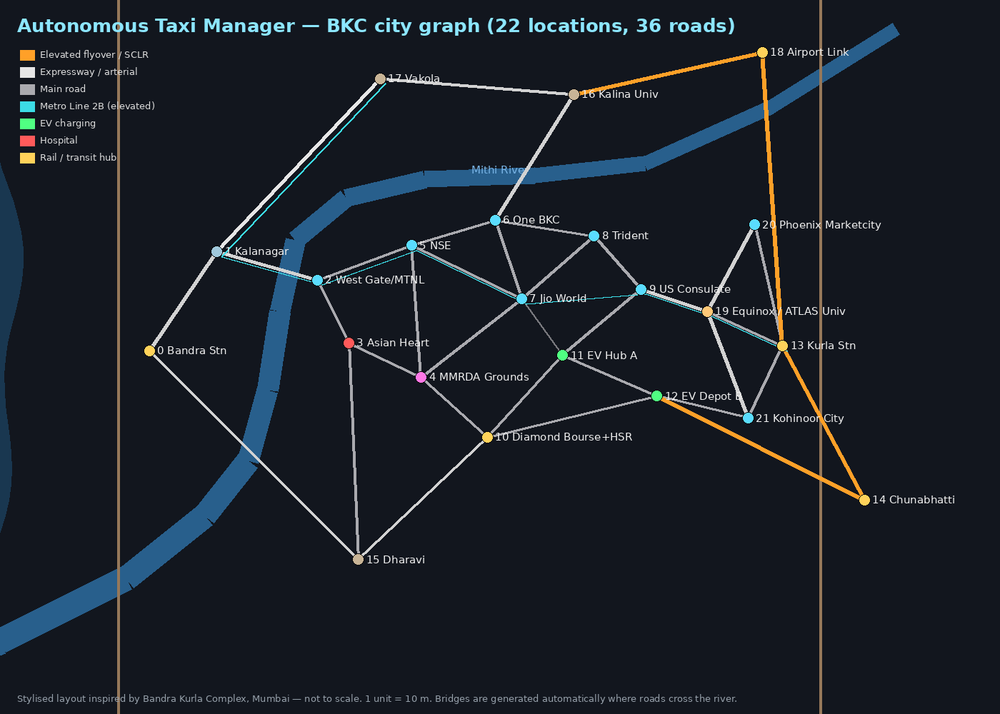
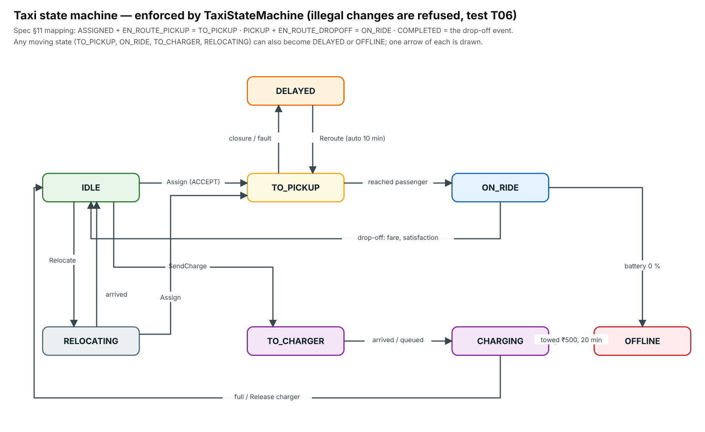
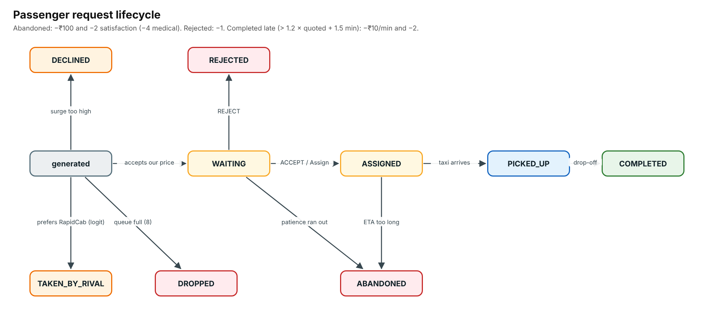
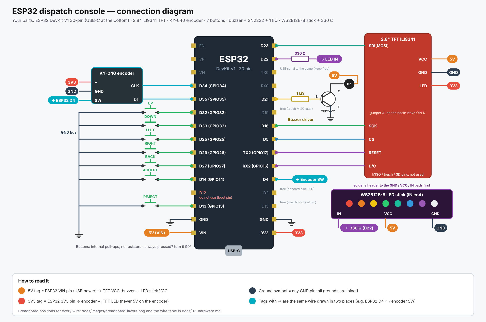
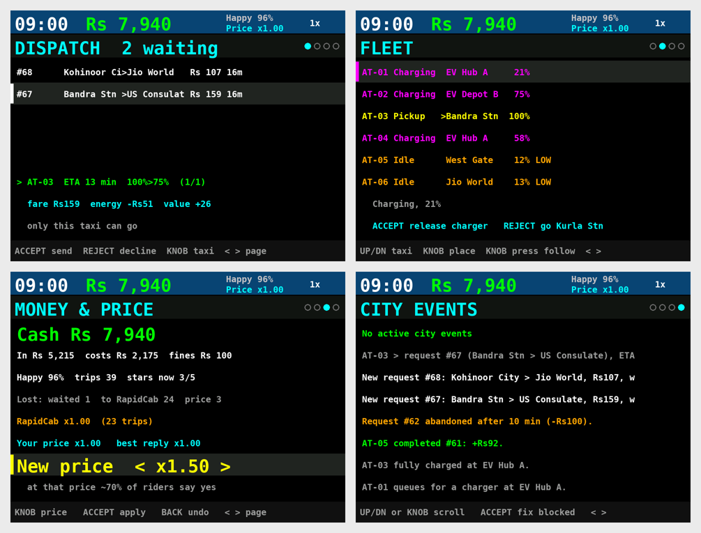
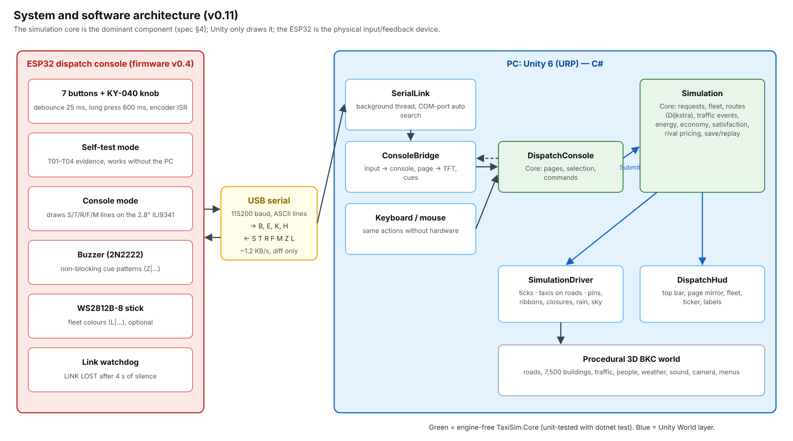
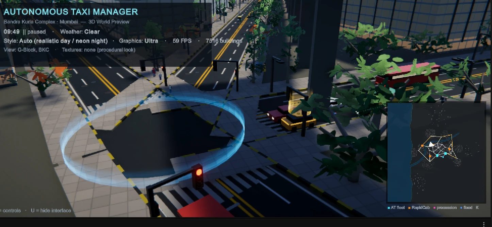
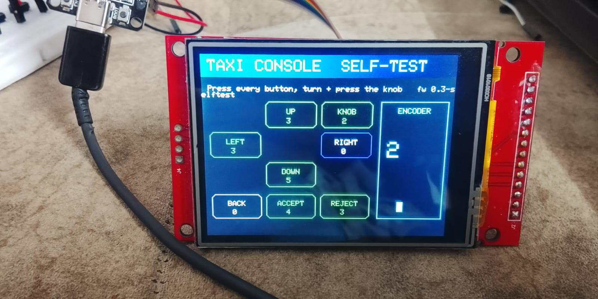
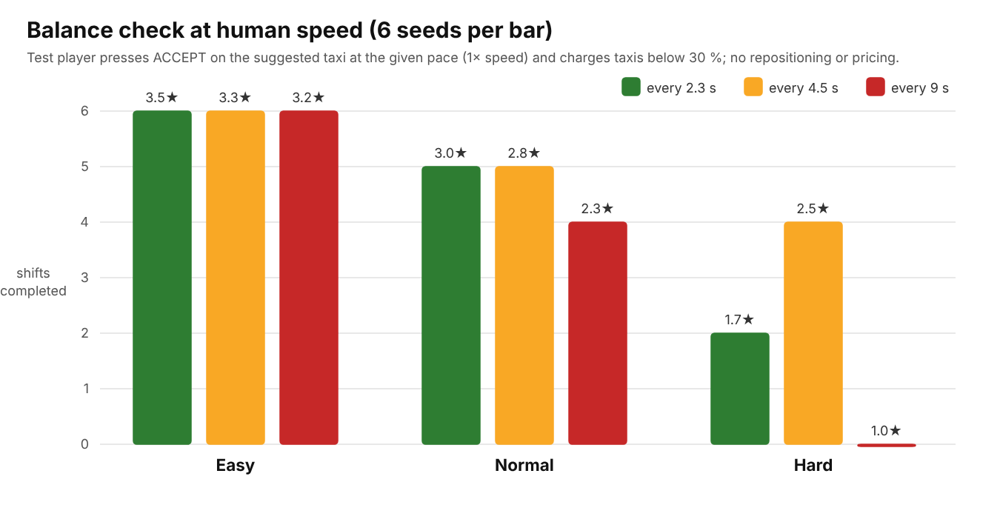

# Autonomous Taxi Manager

## A deterministic fleet-dispatch simulation of Bandra Kurla Complex, Mumbai, played through an ESP32 physical dispatch console

**Pinnacle 1: Game Design Engineering · Project 15 (Simulation)**
B.Tech Artificial Intelligence & Machine Learning, First Year, Semester I

**Team:** Tirth · Sarthak · Zain · Sahil
**Co-ordinator:** Dr. Rishika Aggrawal · **Supervisor:** Prof. Dr. Rabinder Henry
**Version described:** v0.12.1 (November 2026)

---

## Abstract
Autonomous Taxi Manager is a city-management game. The player dispatches a six-car autonomous electric taxi fleet through one working day, 06:00 to 22:00, in a stylised 3D model of Bandra Kurla Complex (BKC), Mumbai.

**What the player does.** Passenger requests arrive according to a rule-based demand model. The player chooses which taxi serves each request, when to charge, how to react to seven kinds of traffic event and what price to charge. A rival fleet, RapidCab, competes for every fare through a logit choice model, and it re-prices hourly as a best response, which turns pricing into a Bertrand-style game with a Prisoner's-Dilemma equilibrium.

**How it is built.**
- **Simulation:** deterministic and engine-free (C#, fixed 15-second ticks, one seeded PCG32 generator). Saves are a command log that replays to an identical state hash.
- **3D world:** Unity 6 draws a procedurally generated city (about 7,500 buildings, traffic, pedestrians, weather) from the same map data the simulation uses.
- **Console:** all decisions are made on a physical console with an ESP32, seven buttons, a rotary encoder, a 2.8-inch TFT and a buzzer. It talks to the game over a text protocol on USB serial.

**Results.**
- 69 automated tests pass. The firmware was also run on a PC against the game's real data stream.
- The console hardware passed its self-test, and the team played complete shifts from the console.
- Balance runs show that Easy is forgiving, Normal rewards attention, and Hard needs the full set of fleet and pricing decisions.

---

## 1. Title page and team roles
The title, team, supervisor and version are given above. The roles follow spec §27.

| Member | Primary role | Secondary role | Main contributions (to complete before submission) |
|---|---|---|---|
| *[name]* | Game / Systems Designer: rules, fleet logic, economy, balancing | Documentation | utility formula, pricing game, balance tables, report |
| *[name]* | Simulation Programmer: requests, routes, taxis, traffic, trips | Testing | simulation core, route engine, unit tests |
| *[name]* | UI / Tools Programmer: 3D city, HUD, TFT pages, ESP32 communication | UI/UX | Unity world, dispatch HUD, serial link |
| *[name]* | Hardware / QA Lead: console, buttons, encoder, LEDs, wiring, playtesting | Integration | breadboard build, self-test, bring-up, playtests |

*Every member must be able to explain the simulation model, the route logic, the hardware interface and their own contribution at the viva (spec §26).*

AI assistance (Claude, Anthropic) was used throughout for code generation, verification tooling, wiring layouts and documentation. The team set the goals, made the design decisions, built and tested the hardware, ran Unity and judged the results. Each AI-generated part was reviewed and tested, and the evidence is in §13.

---

## 2. Simulation concept, player role and objective
**Player and role.** The player is the **operations manager of AT, an autonomous EV taxi fleet**. The taxis drive themselves; the player makes the fleet manager's decisions:
- **accept or reject** each passenger request;
- **which taxi** to send;
- **when to charge** and where idle taxis should wait;
- **how to respond** to closures, jams, rain, festivals, vehicle faults and charger faults;
- **what price** (surge level) to charge against the rival RapidCab.

**Objective.** Survive the shift (06:00–22:00) with the best combination of profit, passenger satisfaction and fleet efficiency:

> score = 0.5 · clamp(profit / ₹25,000, 0, 1) + 0.3 · satisfaction / 100 + 0.2 · efficiency, stars = round(1 + 4 · score)

Efficiency is busy taxi-time divided by available taxi-time.

**Game over.** The shift ends early, and the score is halved, if cash falls below **−₹2,000** (bankrupt) or satisfaction falls below **20 %** (licence cancelled).

**Setting.** BKC is Mumbai's business district, between Bandra and Kurla stations, with a corridor through the Equinox Business Park and ATLAS SkillTech University along LBS Marg. It has a strong morning and evening commuter rhythm, monsoon rain, festival crowds at the MMRDA Grounds and a cardiac hospital (Asian Heart Institute), all of which become gameplay rules.

**Scope.** We built every item of spec §3. The save/load *menu* is the only part not finished: the save and replay code itself is complete and tested (§13). The out-of-scope list from the spec was respected: no real-scale city, no autonomous-driving AI and no machine-learning demand.

---

## 3. City model and assumptions
The city is an **undirected weighted graph G = (V, E)** with |V| = 23 locations and |E| = 38 roads (Figure 1). The same `BkcMap` data drives the route engine *and* the 3D world, so what the player sees is exactly what the simulation routes on.

*Figure 1: The stylised BKC → Equinox / ATLAS → Kurla graph (1 world unit = 10 m).*

**Nodes** have a zone that drives demand and events:
- **rail hubs:** Bandra and Kurla stations;
- **financial and commercial:** NSE, One BKC, Jio World Centre, West Gate, Phoenix Marketcity, Kohinoor City;
- **hospital:** Asian Heart Institute;
- **event venue:** MMRDA Grounds;
- **hotel:** Trident;
- **government:** US Consulate;
- **transit:** Diamond Bourse + HSR, Chunabhatti;
- **airport link:** SCLR;
- **residential and education:** Dharavi, Vakola, Kalina University, Equinox / ATLAS;
- **charging:** EV Hub A (2 bays), EV Depot B (3 bays) and the **AT Fleet Hub** depot (12 bays), where the fleet starts.

**Edges** carry:
- a road class (local, main, arterial or expressway), which sets the free-flow speed: 22, 30, 38 or 55 km/h;
- a length in km;
- a base time `t₀ = km / speed × 60 + 0.3 min` (the fixed 0.3 min stands in for junction delay);
- a traffic multiplier `m ∈ [1, 3]`;
- a `blocked` flag;
- an `elevated` flag for flyovers, which use 5 % more energy.

**Assumptions:**
1. The layout is inspired by the real area but is simplified and not to scale. The spec warns against modelling an entire real city, and a readable graph matters more for dispatch decisions.
2. Roads are two-way. Signals and turns are abstracted into the junction delay. In the 3D world, signals exist visually, and the ambient traffic stops at them.
3. Travel time on an edge = `t₀ × m`. Rush hours and events change `m`; closures set `blocked`.
4. Each taxi is a point on an edge with a progress value between 0 and 1. Taxis do not interact in the simulation (no congestion between fleet cars). Traffic density is represented by `m`.

---

## 4. Taxi, request and traffic state machines
**Taxis** (Figure 2). Each taxi state maps onto the spec §11 states:
- **IDLE**;
- **TO_PICKUP** (spec ASSIGNED + EN_ROUTE_PICKUP);
- **ON_RIDE** (spec PICKUP + EN_ROUTE_DROPOFF);
- **TO_CHARGER**;
- **CHARGING**;
- **DELAYED**;
- **OFFLINE**;
- **RELOCATING**, for repositioning: an extension of the spec.

COMPLETED is the drop-off *event*, which pays the fare and returns the taxi to IDLE. `TaxiStateMachine` stores the allowed transitions as a table. Every change goes through `TrySetState`, which refuses anything else. Test T06 tries every pair.

*Figure 2: Taxi states and transitions.*

**Requests** (Figure 3). When a request is generated, three things can stop it before it reaches the player:
- the passenger compares us with RapidCab and may choose RapidCab (**TAKEN_BY_RIVAL**);
- the passenger may refuse our surge price (**DECLINED**);
- the queue may be full (**DROPPED**, limit 8).

Otherwise it is **WAITING**. From there it becomes ASSIGNED, then PICKED_UP, then COMPLETED. It ends early as **REJECTED** (the player's decision) or **ABANDONED** (the patience timer ran out).

*Figure 3: Passenger request lifecycle with its penalties.*

**Traffic events** have a scheduled start and end tick, and are either random (about 1.3 per hour on Normal) or scripted:

| Event (spec §16) | Effect in the simulation | Player response |
|---|---|---|
| Road closure | edge blocked; taxis whose route crosses it stop as DELAYED | REROUTE (auto after 10 min) |
| Heavy traffic | ×2.2 on one road, ×1.35 on its neighbours | choose another taxi; the route engine avoids it |
| Rain | ×1.35 on every road; demand +30 %; patience −10 % | prioritise urgent requests |
| Festival (MMRDA) | one road closed; ×1.8 around the venue; demand ×3 there | move taxis towards it |
| Vehicle issue | one taxi DELAYED for 10–20 min | reassign its job |
| Charging queue | one charger out of service | charge earlier or elsewhere |
| Demand surge | ×2.5 requests from one location | reposition idle taxis |

---

## 5. Game loop and simulation tick
The simulation advances in **fixed ticks of 15 simulated seconds**, so the shift is 3,840 ticks. Player commands are applied immediately and logged with their tick. Each tick runs in this fixed order:
1. events start and end;
2. traffic multipliers and closures are updated (a rush-hour profile peaking at 09:15 and 18:45, scaled by road class, plus event effects);
3. RapidCab re-prices, once per simulated hour;
4. new requests arrive (a Poisson-like count from the demand rate); each passenger picks a provider and accepts or declines the price;
5. waiting time is added, and passengers who run out of patience give up;
6. taxis move along their routes and use energy; arrivals, charging, towing and delays are handled;
7. the game-over checks and the end of the shift.

**Real-time pacing.** In Unity, `SimulationDriver` turns frame time into ticks. At 1×, one simulated minute takes 3 real seconds, so a whole shift is 48 minutes; 2×, 4× and 8× are also available, along with pause. Between ticks, the taxis' positions are interpolated so they glide along the roads.

**Determinism.** All randomness comes from one seeded **PCG32** generator [7]. Lists are iterated in a fixed order, and ties are broken by id. As a result:
- the same seed plus the same commands always gives the same game;
- an FNV-1a hash of the whole state fingerprints it;
- a **save file** is just the seed, the difficulty, the tick, the hash and the command log. Loading replays the log and must reproduce the hash.

A full shift simulates in about 0.1 s. That made it practical to balance the game over hundreds of automated shifts (§13).

---

## 6. Route and pathfinding method
Routes use **Dijkstra's algorithm** [1] with edge weight `w(e) = t₀(e) × m(e)`, skipping blocked edges. With 23 nodes, an O(|V|²) implementation is fast and easy to explain at the viva. Ties are broken by the lowest node id, which keeps routing deterministic. If no path exists, the result reports a failure with a reason instead of returning an invalid route, which is the behaviour spec §22 asks for.

**Where routes are used:**
- pickup ETAs for every taxi (dispatch ranking);
- the trip quote at pickup, used for lateness;
- the nearest charger;
- reroutes after closures;
- RapidCab's ETAs;
- the ribbons drawn in the 3D city (Figure 6).

**Evidence:**
- `T07_RouteIsValidChainOfRoads`: every pair of consecutive nodes is joined by the listed road, and the time and distance are the sums over the edges.
- `T08_BlockedRoad_FindsAlternative` and `T08_IsolatedLocation_ReportsFailure`.
- `HeavyTraffic_ChangesTheFastestRoute`.
- `Routing_IsDeterministic`, which checks all 23 × 23 pairs on two separately built graphs.

---

## 7. Fuel, charging and economy model
| Quantity | Model (Normal difficulty) |
|---|---|
| Energy | `2.5 % per km × (1 + 0.5 (m − 1))`, ×1.05 on flyovers. Traffic adds consumption, as spec §14 asks. |
| Dispatch rule | refused unless the battery after the pickup *and* the trip is still ≥ **10 %** |
| Low battery | below 20 % the taxi is flagged LOW (orange on the HUD, TFT and LEDs) |
| Charging | +2 % per simulated minute, **₹2 per %**; limited bays per station with a first-in-first-out queue |
| Empty battery | OFFLINE, a **₹500 tow**, −3 satisfaction; after 20 min the taxi is put on the nearest charger |
| Fare | `₹60 + ₹22/km + ₹2/free-flow minute`, ×1.25 priority, ×1.5 medical, × the surge locked at booking |
| Lateness | if the ride takes longer than `1.2 × quoted + 1.5 min`: ₹10 per late minute (maximum ₹300) and −2 satisfaction (−4 medical) |
| Abandoned | −₹100 and −2 satisfaction (−4 medical); rejected: −1 satisfaction |
| Fixed costs | ₹300 per taxi per day; start cash ₹5,000 |
| Satisfaction | on-time drop-off +1 (priority +2, medical +3); a surge of ×1.75 or more costs −1 per ride |

**Demand** (spec §12, rule-based):
- **Rate:** `30 requests/h × (0.6 + 0.9·peak₉ + 0.8·peak₁₈.₅ + 0.3·lunch)`, ×1.3 in rain.
- **Places:** origins and destinations are weighted by zone and time of day. Stations generate trips in the morning and attract them in the evening; offices do the opposite.
- **Urgency:** 70 % normal, 22 % priority and 8 % medical. Medical trips always go to the hospital.
- **Patience:** 12–20 min normal, 9–13 min priority, 7–10 min medical.

### 7.1 Dispatch suggestion: a utility function
For the selected request, every taxi is scored as follows:

> U = fare·s − 1.0·energy₹ − 8·ETA·w − 150·P(abandon) + 15·ΔSat

- `w` (the urgency weight) is 1, 1.8 or 3;
- `P(abandon) = σ((ETA − patience left) / 1.5)`;
- `ΔSat` is +2w if the taxi arrives in time, otherwise −5.

Infeasible taxis (busy, or not enough charge) are listed with the reason. The console suggests the highest-U taxi; the knob cycles through the others. The HUD shows every term (Figure 5), so the policy is never a black box, as spec §29 requires.

### 7.2 The pricing game against RapidCab
Passengers compare the generalised cost `C = fare·s + ₹6/min × ETA` of both providers. They choose us with logit probability [8]:

> P(us) = 1 / (1 + e^{0.035 (C_us − C_rival)})

and then accept our price with probability `1 − 0.6(s − 1) − 0.3·wait/patience`.

The table below gives the expected revenue per ₹150 request at equal ETAs, for each pair of surge levels:

| You \ RapidCab | ×1.0 | ×1.25 | ×1.5 | ×1.75 | ×2.0 |
|---|---|---|---|---|---|
| **×1.0** | **75.0** | 118.2 | 139.9 | 147.1 | 149.2 |
| ×1.25 | 33.8 | 79.7 | 125.6 | 148.6 | 156.3 |
| ×1.5 | 10.6 | 33.4 | 78.8 | 124.1 | 146.9 |
| ×1.75 | 2.8 | 9.8 | 30.6 | 72.2 | 113.8 |
| ×2.0 | 0.6 | 2.3 | 8.1 | 25.4 | 60.0 |

- The only pure **Nash equilibrium** [9] is (×1.0, ×1.0). This is Bertrand price competition [10].
- Both fleets would earn more at (×1.25, ×1.25): 79.7 each instead of 75. But each gains by undercutting (118.2), so the game is a **Prisoner's Dilemma**.
- RapidCab plays its best response every simulated hour.
- In play, surge is still useful in the rush. When demand exceeds the fleet's capacity, a higher price passes the overflow to RapidCab instead of letting passengers abandon, which costs ₹100 and satisfaction each time.
- The Money page shows this table live, with the best reply highlighted.

---

## 8. ESP32 architecture and dispatch console
**Hardware** (spec §5; full wiring in docs/03):

| Function | Part | ESP32 pin | Notes |
|---|---|---|---|
| UP / DOWN / LEFT / RIGHT | 6 × 6 mm tactile switches | GPIO 32 / 33 / 25 / 26 | INPUT_PULLUP, switch to GND |
| BACK / ACCEPT / REJECT | tactile switches | GPIO 27 / 14 / 13 | GPIO 12 (a boot strap) avoided |
| Knob turn (CLK / DT) | KY-040 | GPIO 34 / 35 | input-only pins; the module's own 10 kΩ pull-ups; powered from 3.3 V |
| Knob press | KY-040 SW | GPIO 4 | |
| Display | 2.8" ILI9341 SPI 320×240 | SCK 18, MOSI 23, CS 5, D/C 16 (RX2), RESET 17 (TX2) | VCC 5 V through the module's regulator (J1 open); backlight 3.3 V |
| Buzzer | 12 mm buzzer | GPIO 21 → 1 kΩ → 2N2222 base | the buzzer switched on the 5 V side |
| Status LEDs (optional) | WS2812B-8 stick | GPIO 22 → 330 Ω → DIN | 25 % brightness cap; not fitted yet |

*Figure 4: Connection diagram for the team's exact parts.*

**Building it on a breadboard.** Our 30-pin ESP32 is 1 inch wide, so on one breadboard it leaves free holes on only one side (bug B018). The final build therefore places the ESP32 beside the breadboard, with every connection made by a jumper whose female end sits on the pin. A script describes all 38 wires hole by hole and checks them automatically:
- every connection is correct;
- each button works whichever way round it is inserted, pressed or released;
- 3.3 V, 5 V and GND are never shorted.

Deliberately planted mistakes, such as the buzzer + on GND or the encoder on 5 V, were all caught. The as-built wiring is shown in `docs/images/as-built-layout.png`.

**Firmware v0.4** (`firmware/wokwi/sketch.ino`, Arduino C++):
- **Inputs:** each button needs 25 ms of stable signal to count. Holding 600 ms is a long press, reported once. The knob is read by an interrupt on both encoder pins with a 16-entry quadrature state table, 4 steps per detent.
- **Modes:** at power-on the console runs a **self-test**: every button lights a box and beeps, and "ALL INPUTS OK" appears when everything has been used. This is the evidence for T01–T04 (Figure 8). On the first line from the game it switches to **console mode** and draws what the game sends.
- **Screen:** a header (clock, cash, satisfaction, price, speed), a title with page dots, 8 rows that each redraw only when they change, and a footer or toast.
- **Feedback:** non-blocking buzzer patterns, and LED colours when the stick is fitted.
- **Watchdog:** if the game falls silent for 4 s, the console shows **LINK LOST** and beeps once.

**Protocol** (USB serial, 115200 baud, ASCII lines):

| Direction | Lines | Meaning |
|---|---|---|
| Console → game | `B,ACCEPT,P` / `L` / `R` | button press / long press / release |
| | `E,+2` | encoder steps |
| | `H,TAXI-CONSOLE,0.4-game` | hello at boot |
| | `K` | keep-alive, once a second |
| Game → console | `S\|09:00\|Rs 7,940\|96%\|x1.00\|1x` | header |
| | `T\|page\|pages\|title` | page title |
| | `R\|row\|style\|text` | row; style = colour, `*` selected, `2` large |
| | `F\|…` | footer |
| | `M\|colour\|text` | toast |
| | `Z\|cue` | buzzer pattern |
| | `L\|rrggbb×8` | LED colours |

The game sends only changed lines: about 0.7–1.2 KB/s, against about 11.5 KB/s available.

*Figure 5: The four console pages (Dispatch, Fleet, Money & Price, City Events), drawn from the game's real output during a played shift.*

**Controls** (keyboard equivalents in Appendix C). Buttons have fixed jobs:
- **ACCEPT** sends a taxi, charges, reroutes or applies a price;
- **REJECT** declines a request or moves a taxi;
- **BACK** undoes a choice;
- **UP/DOWN** select;
- **LEFT/RIGHT** change page.

Long presses add a second layer: hold LEFT/RIGHT to change speed, BACK to pause, and the KNOB for camera mode. The knob always means "choose among options": taxi, place or price. When a button broke during the build, its INFO role moved to LEFT/RIGHT, so seven buttons were enough.

---

## 9. Software architecture

*Figure 6: System and software architecture.*

The software has **three layers** (docs/04 has the full module table):
1. **TaxiSim.Core** (green in Figure 6) holds all the rules. It is plain C# with no Unity dependency:
   - `CityGraph`, `BkcMap` and `RouteFinder` (the city and routing);
   - `Simulation` with `Taxi`, `RideRequest`, `TrafficEvent` and `Command`;
   - `SurgePricing` (the game theory), `SaveGame`, and `AutoDispatcher` (an autopilot used for balancing);
   - `DispatchConsole` (the console's pages, selection and command logic) and `ConsoleProtocol` (the line format).

   The same source files compile in Unity and in the test project.
2. **Unity World layer** (blue) draws the state and collects input:
   - `SimulationDriver` runs the ticks and moves the vehicles;
   - `DispatchHud` is the laptop panels;
   - `ConsoleBridge` connects input and the TFT;
   - `SerialLink` runs on a background thread and searches the COM ports;
   - the procedural world, menus and camera.
3. **Firmware** handles input and feedback on the ESP32.

Every spec §18 module maps onto these classes:
- **InputManager:** firmware debounce → SerialLink → ConsoleBridge → DispatchConsole.
- **Request, Fleet, Trip, Traffic, Economy and Satisfaction managers:** sections of `Simulation`.
- **Route manager:** `RouteFinder`.
- **UI manager:** `DispatchHud` plus the TFT pages.
- **Feedback manager:** cues to the buzzer and LEDs.
- **Save manager:** `SaveGame`.
- **Test and debug layer:** the tests, the autopilot and `tools/verify`.

Because console input becomes logged commands, a shift played on the hardware can be replayed exactly.

---

## 10. UI/UX and dashboard design
**Two synchronised screens.**
- The **TFT** on the console shows the *current page*, so the player can play while looking at the console.
- The **laptop HUD** shows the same page in more detail, plus everything else at a glance:
  - the clock and speed, cash, a satisfaction bar, and the two fleets' prices;
  - the fleet panel with battery bars;
  - the event ticker, toasts and the end-of-shift star card.

Both screens are built from the same `DispatchConsole` state, so they cannot disagree (acceptance criterion: "TFT/dashboard synchronised").

**Design choices (usability heuristics [11]):**
- **Visibility of system status:** the clock, cash, satisfaction, link status and each taxi's state are always on screen.
- **Recognition rather than recall:** the footer always shows what each button does on the current page, for example "ACCEPT send · REJECT decline · KNOB taxi".
- **Explain the AI:** the suggested taxi shows the utility terms, and alternatives are one knob-turn away.
- **Consistent colour language** across the HUD, TFT, LEDs and 3D labels:
  - green: idle / OK;
  - yellow: pickup;
  - blue: passenger on board;
  - magenta: charging;
  - orange: delayed / low;
  - red: medical / empty / error.

  Colour is always paired with text, so it doesn't rely on colour vision.
- **Error prevention:** infeasible taxis cannot be sent, and the reason is shown ("not enough charge (needs 34 %, has 22 %)").
- **Sound with meaning:** each cue has its own short pattern (new, urgent, event, warning, coin, error).

**The 3D city as the map** (Figure 7):
- the Unity 6 URP world is generated at start-up from the simulation's own map;
- passenger pins glow green, gold or red;
- the selected trip shows as a cyan ribbon, and the chosen taxi's route to the pickup as an orange one;
- closed roads get barriers, and ambient traffic turns back at them;
- simulated rain switches on the monsoon, the simulation clock drives the sky, and the traffic heat overlay mirrors the simulation's multipliers.

The world contains 7,516 buildings, 22 landmarks, 17 signalised junctions, 250 vehicles and 400 walkers (plus 1,112 standing people), 15 custom HLSL shaders (148 passes) and 22 procedurally synthesised sounds. It runs at 59 FPS on the Ultra tier on the team's laptop, and five graphics tiers scale it for weaker machines.

*Figure 7: The 3D BKC world in Unity (team screenshot): status panel, signals, traffic, minimap with the AT fleet (cyan) and RapidCab (orange). Add a screenshot of the dispatch HUD during a shift here (F9 saves one).*

---

## 11. BOM and budget
The full table is in docs/05.

| Group | Main items | ₹ (estimated, to be replaced with receipts) |
|---|---|---|
| Electronics | ESP32 DevKit V1, 2.8" ILI9341, 8 tactile switches, KY-040, WS2812B-8, buzzer, 2N2222 ×2, resistors, 74HC125, 830-point breadboard, two jumper sets, USB-C cable | ≈ 2,190 |
| Enclosure | 3 mm MDF/acrylic panel, sides, M3 standoffs, caps, knob, misc | ≈ 1,100–1,950 |
| Software | Unity Personal, Arduino IDE, Visual Studio Community, Wokwi | 0 |
| **Total** | | **≈ ₹3,300–4,500**, about 25–35 % of the ₹12,000 lower bound of the band |

The spend is low because one ESP32 does all the I/O, the PC renders the city, every asset is procedural and every tool is free. The spec's optional vibration motor was not bought, because the buzzer and LEDs already cover alerts.

---

## 12. Implementation highlights
1. **One engine-free core, three consumers.** The same C# files run inside Unity, in the unit tests and in two offline tools: a generator of the game's real console data stream, and a balance runner.
2. **Deterministic replay.** A save is a command log. Replaying it on a fresh simulation must give the identical FNV-1a state hash, so a save works both as save/load (T14) and as a regression test (T18).
3. **Explainable dispatch AI.** The utility function and the live Nash table make the "AI" a documented formula, not a black box.
4. **A data-driven 3D city.** Roads, bridges (wherever a road crosses water), flyovers, buildings with no overlaps (a space registry) and landmarks are all generated from the same map the simulation routes on.
5. **Simulation-driven traffic in a living city.** The fleet taxis are positioned by the simulation, interpolated between ticks. They are still part of the ambient traffic model, so other cars queue behind them and stop at red lights.
6. **A robust hardware link.** Automatic COM-port discovery, line diffing, LINK LOST on both sides, and a keyboard fallback, so the game never depends on the cable.
7. **Testing the firmware without hardware.** The real firmware source is compiled on a PC with stand-in Arduino libraries and fed the game's actual line stream. It is checked for crashes and memory errors (AddressSanitizer and UndefinedBehaviourSanitizer) and draws a text copy of the TFT. This caught a real bug (B017). A second check mimics the Arduino IDE's preprocessing after bug B015.
8. **Machine-checked wiring.** The breadboard plan is a netlist with automatic checks, tested by mutation, and the drawing is checked for crossing wires.

---

## 13. Testing and playtesting
The full matrix is in docs/07. Status on 2026-11-11:

| Area | Evidence | Status |
|---|---|---|
| T01–T03 power, buttons, encoder | self-test on the real console, ALL INPUTS OK (Figure 8); serial lines | PASS |
| T04 debounce | 25 ms firmware debounce, long-press check in the harness | PARTIAL (rapid-press count to record) |
| T05–T13 simulation | named unit tests (e.g. `T07_RouteIsValidChainOfRoads`, `T11_FullChargerQueuesTheNextTaxi`, `T13_AbandonedRequestCostsMoneyAndSatisfaction`) | PASS |
| T14 save/load | `T14_SaveThenLoad_ReplaysToTheIdenticalState`, `T14_TamperedSaveIsDetected` | PARTIAL (menu buttons are future work) |
| T15 boundary | empty battery → tow; busy taxi refused; queue limit; bad serial lines ignored | PASS |
| T16 long run | 10 complete simulated shifts with invariants; 59 FPS | PARTIAL (20-minute console session to record) |
| T17 playtest | form ready (docs/07 §4) | TO RECORD |
| T18 regression | golden whole-shift hash; `run_checks.sh` after every version | PASS |
| Integration | team played full shifts from the console; protocol harness 12/12; wiring netlist; Arduino IDE build | PASS |

- **Automated suite:** 69 test cases pass.
- **`tools/verify/run_checks.sh`** also:
  - type-checks every Unity script against Unity's reference assemblies (both input systems and the serial path);
  - compiles all 148 shader passes against the Unity 6 URP library;
  - renders all 22 sounds;
  - runs the firmware harness.

*Figure 8: The console's self-test on the real hardware (T01–T03 evidence).*

**Balance.** An autopilot that dispatches perfectly completes every difficulty (20/20 shifts, 4.0 stars). Doing nothing is fired at about 08:36. A *human-speed* bot, which presses ACCEPT on the suggestion every 2–9 s, gave these results (Figure 9):

| Difficulty | Shifts completed | Stars |
|---|---|---|
| Easy | 6/6 | 3.2–3.5 |
| Normal | 4–5/6 | 2.3–3.0 |
| Hard | 0–4/6 | — |

The difficulty curve is sensible: Hard requires the Fleet and Money pages.

*Figure 9: Shifts completed and average stars at three human dispatch speeds.*

---

## 14. Bug and iteration history
The project went through more than 20 tagged versions in two weeks of intensive development (CHANGELOG, 29 Oct – 19 Nov 2026):
- **v0.1:** plan;
- **v0.2–v0.4:** 3D BKC world, Kurla corridor, neon style;
- **v0.5–v0.8:** realism, street life, sound, cinematic mode;
- **v0.9:** the simulation core;
- **v0.10:** realism pass and console hardware;
- **v0.11:** the integrated, playable game;
- **v0.12:** the complete documentation set and this report; **v0.12.1:** a settings fix found by the team (B019).

The bug log (docs/09) records 19 issues with their root cause, fix and covering test. Representative examples:

| ID | Symptom | Root cause | Fix |
|---|---|---|---|
| B005 | distant towers looked like TV static | window detail finer than a pixel | distance level-of-detail in the tower shader |
| B012 | Normal shifts ended with the player fired by 09:30 even with perfect dispatch | demand above capacity, unrecoverable penalties | softer penalties, lateness measured against the quoted time, surge rations demand; 60 seeded shifts now complete |
| B013 | RIGHT and BACK never registered | button GND links in the wrong holes | rewired per the layout; self-test OK |
| B014 | no COM port in Arduino | missing CP2102 driver | installed the Silicon Labs driver → COM8 |
| B015 | Arduino IDE: "'Note' does not name a type" | IDE inserts function prototypes above the struct | struct moved up; IDE emulation added to the checks |
| B017 | TFT showed "(0/6)" for the suggested taxi | two candidate lists compared by reference | compare by id; regression test |
| B018 | the ESP32 covered the breadboard rows b–j | 1-inch-wide board | ESP32 placed beside the breadboard; layout re-verified |
| B019 | Settings time-of-day slider snapped back | during a shift the game set the sky to the shift clock every frame, and kept doing so after the shift ended | a Settings button frees the sky (looks only); the clock is released when the shift ends |

**Design iterations worth noting:**
- **8 buttons → 7.** After one button broke, INFO was folded into LEFT/RIGHT.
- **Separate buttons per page → context-dependent ACCEPT/REJECT**, with a footer hint that always shows what they do.
- **Rewiring for the real board width:** a breadboard layout for the 1-inch-wide board (one free row per side) proved impossible, then the ESP32 was moved beside the breadboard.
- **Fixed IDs → automatic COM-port discovery** after watching the team set up drivers.

---

## 15. Results and player feedback
**Results against the spec's acceptance criteria (§26):**
- ✔ Six taxis are represented and managed, each with a defined state.
- ✔ At least five requests can wait (up to 8 are queued).
- ✔ Accept, reject, assign and reroute are done on the physical controls (team-verified end to end).
- ✔ Routes are calculated on the city network.
- ✔ Traffic events alter routes and travel times.
- ✔ Battery and charging change availability.
- ✔ Completed trips produce income and satisfaction changes.
- ✔ Shift completion and game over both work.
- ✔ The TFT and dashboard stay synchronised, because both are built from the same state.
- ◐ Save/load: the replayable save works in the core; the documented reset is Esc → Main menu → new shift.
- ◐ Testing: functional, boundary, hardware, balance, performance and regression evidence is complete. Usability (T17) is to be recorded.

**Player feedback:** *to be completed from the T17 playtests (docs/07 §4).* Record at least three first-time players: time to the first dispatch, whether they found the pages by themselves, perceived difficulty and fun (1–5), and direct quotes. Then list the changes made in response.

So far the team has confirmed one thing on the real hardware (11 Nov 2026): a shift can be played entirely from the console, with the TFT switching from self-test to the game and every button and the knob working. *[Team: add your own observations from your sessions here — what felt easy or confusing, the pace at 1×, which pages you used most — and then the T17 results.]*

---

## 16. Limitations and future work
- **Save/load menu:** add Save and Load buttons to the pause menu. The core `SaveGame` is ready and tested.
- **LED stick:** fit the WS2812B-8 (it needs a soldered header) and set `HAS_LEDS 1`. The protocol and firmware already drive it.
- **Enclosure:** build the 240 × 140 × 65 mm box (docs/10); use panel-mount buttons so the breadboard stays inside.
- **Map realism:** the graph is stylised. A real OpenStreetMap import was considered and dropped to keep the graph readable and the project offline.
- **Demand model:** rule-based, as Semester I requires. Future work could learn demand from trip data (AI/ML), or let RapidCab learn its pricing.
- **Simulation abstraction:** fleet taxis don't congest each other in the simulation, and signals are abstracted into the junction delay.
- **Platform:** tested on one Windows laptop. The USB link needs Unity's .NET Framework API level, which the Setup menu sets.
- **Playtesting:** T17 still needs to be run, and the balance tuned from real players rather than bots.

---

## 17. Conclusion
Autonomous Taxi Manager meets the brief: it is a **simulation-first** game in which a physical ESP32 console is the only way to make decisions.
- **The rules:** a small, explainable model covering a graph city, Dijkstra routing, a strict taxi state machine, rule-based demand, seven event types, an energy and charging economy, satisfaction, and a documented pricing game. All of it is deterministic, so every shift can be replayed and every rule is unit-tested.
- **The presentation:** a 3D BKC that turns the abstract graph into a city a player can read, and a console whose screen, sound and buttons make dispatching physical.
- **The engineering lessons** were as much about process as code:
  - measure the real parts before designing the layout;
  - make the rules testable without the engine;
  - test the firmware without the hardware;
  - log every bug with the test that now covers it.

---

## 18. References (IEEE style)
[1] E. W. Dijkstra, "A note on two problems in connexion with graphs," *Numerische Mathematik*, vol. 1, no. 1, pp. 269–271, 1959.
[2] Unity Technologies, "Universal Render Pipeline," *Unity 6 Manual*, 2025. [Online]. Available: https://docs.unity3d.com/
[3] Espressif Systems, *ESP32 Series Datasheet*, v4.x. [Online]. Available: https://www.espressif.com/
[4] Ilitek, *ILI9341 a-Si TFT LCD Single Chip Driver 240RGB×320 Resolution and 262K Color — Datasheet*, v1.11, 2011.
[5] Worldsemi, *WS2812B Intelligent Control LED Integrated Light Source — Datasheet*.
[6] Silicon Labs, *CP2102/9 Single-Chip USB to UART Bridge — Datasheet*, and *CP210x USB to UART Bridge VCP Drivers*. [Online]. Available: https://www.silabs.com/
[7] M. E. O'Neill, "PCG: A family of simple fast space-efficient statistically good algorithms for random number generation," Harvey Mudd College, Claremont, CA, USA, Tech. Rep. HMC-CS-2014-0905, 2014.
[8] K. E. Train, *Discrete Choice Methods with Simulation*, 2nd ed. Cambridge, U.K.: Cambridge Univ. Press, 2009.
[9] J. F. Nash, "Equilibrium points in n-person games," *Proc. Nat. Acad. Sci. USA*, vol. 36, no. 1, pp. 48–49, 1950.
[10] J. Tirole, *The Theory of Industrial Organization*. Cambridge, MA, USA: MIT Press, 1988.
[11] J. Nielsen, "Enhancing the explanatory power of usability heuristics," in *Proc. ACM CHI Conf. Human Factors in Computing Systems*, 1994, pp. 152–158.
[12] J. Schell, *The Art of Game Design: A Book of Lenses*, 3rd ed. Boca Raton, FL, USA: CRC Press, 2019.
[13] T. Fullerton, *Game Design Workshop: A Playcentric Approach to Creating Innovative Games*, 4th ed. Boca Raton, FL, USA: CRC Press, 2018.
[14] M. Treiber, A. Hennecke, and D. Helbing, "Congested traffic states in empirical observations and microscopic simulations," *Phys. Rev. E*, vol. 62, no. 2, pp. 1805–1824, 2000.
[15] J. van Dongen, "Interior mapping: A new technique for rendering realistic buildings," in *Proc. Computer Graphics International*, 2008.
[16] G. Fowler, L. C. Noll, K.-P. Vo, and D. Eastlake, "The FNV non-cryptographic hash algorithm," IETF Internet-Draft draft-eastlake-fnv, 2019.
[17] Adafruit Industries, "Adafruit GFX Graphics Library" and "Adafruit ILI9341 Arduino Library." [Online]. Available: https://github.com/adafruit
[18] Mumbai Metropolitan Region Development Authority, "Bandra-Kurla Complex," MMRDA. [Online]. Available: https://mmrda.maharashtra.gov.in/ (map inspiration only; no data imported).

*Before submission: check each online reference and add the access date ("Accessed: Nov. 2026").*

---

### Appendix A: Document index (deliverables)
| Deliverable (spec §28) | Where |
|---|---|
| D1 Concept | docs/01-concept.md |
| D2 Simulation architecture | docs/02-simulation-architecture.md, docs/06-game-design-balancing.md |
| D3 Hardware experiment | docs/03-hardware.md, docs/15-hardware-inventory.md, docs/hardware-photos/ |
| D4 Software architecture | docs/04-software-architecture.md |
| D5 BOM + budget | docs/05-bom-budget.md |
| D6 Vertical slice | the playable shift (docs/16-dispatch-game.md), v0.11 |
| D7 Testing evidence | docs/07-test-plan.md, docs/09-bug-log.md, docs/images/evidence/ |
| D8 Final build | unity/, firmware/, docs/12-windows-setup-guide.md, docs/08-user-manual.md |
| D9 Final report | this document |
| D10 Demonstration + viva | Appendix B (demo script), Appendix C (controls) |

### Appendix B: 4-minute demo script (D10)
1. **0:00:** "We run Mumbai's robot taxi fleet." Show the console on its self-test, then press Play: the console switches to TAXI MANAGER.
2. **0:30:** Start a Normal shift. Fly to the Fleet Hub, show the pins and the first request on the TFT.
3. **1:00:** Dispatch two requests. On the laptop, point out the utility breakdown; turn the knob to an alternative taxi and explain why it scores lower.
4. **1:45:** Fleet page: send a low taxi to charge. Money page: show the payoff table and Nash equilibrium, then set ×1.25 and explain the trade-off.
5. **2:30:** Wait for, or script, a road closure: barrier, DELAYED taxi, ACCEPT reroutes on the Events page. Show the T08 test passing.
6. **3:15:** Hold the knob for camera mode and fly over the city. Switch to 8× to reach the evening rush and the monsoon.
7. **3:45:** End card with the stars. Close with: "every decision was logged, so this exact shift can be replayed."

### Appendix C: Keyboard and mouse controls
The console's seven buttons and knob also have keyboard equivalents, so the game can be tested and demonstrated without the hardware. The full list:

| Key | What it does |
|---|---|
| **Dispatch (during a shift; same as the console)** | |
| ↑ / ↓ | UP / DOWN: select a request or taxi, scroll |
| ← / → | LEFT / RIGHT: previous / next page (Dispatch · Fleet · Money · Events) |
| Enter | ACCEPT: send the taxi · charge / reroute / release · apply the price; also starts a shift |
| Backspace | REJECT: decline the request · send the taxi to the chosen place |
| Delete | BACK: back to the suggested taxi / undo the price |
| , and . | knob turn: choose another taxi / place / price |
| / | knob press: show the selection in the city |
| P | hold BACK: pause / continue the shift |
| − and = | hold LEFT / RIGHT: slower / faster (1× 2× 4× 8×) |
| **Camera (always)** | |
| W A S D | move the camera (arrow keys too, when no shift is running) |
| Q / E | turn left / right |
| R / F | tilt up / down |
| Z / X, mouse wheel | zoom in / out |
| right / middle mouse drag | turn and tilt / move |
| Tab / Shift+Tab | fly to the next / previous landmark |
| Space | follow the next fleet taxi |
| H | home view |
| G | street-level chase camera |
| C | cinematic tour on / off |
| J | next cinematic shot |
| Esc | stop following / leave the tour, then the pause menu |
| **City and look** | |
| T | time-lapse on / off |
| [ / ] | time of day −/+ 30 min |
| 1 / 2 / 3 / 4 | morning / noon / evening / night |
| M | weather: Clear → Haze → Monsoon |
| Y | festival: None → Ganpati → Diwali |
| V | look: Auto → Neon 2077 → Realistic |
| B | miniature (tilt-shift) effect |
| O | traffic heat overlay (free-roam only) |
| P / Shift+P / Shift+O | route demo / close a road on it / reopen all roads (free-roam only) |
| **Screen and settings** | |
| I | controls help (free-roam) |
| L | place labels on / off |
| U | hide / show the whole interface |
| K | minimap: Small → Large → Off |
| N | sound mute / unmute |
| F1 – F5 | graphics: Low · Medium · High · Ultra · Cinematic |
| F9 | save a screenshot |

During a shift the arrow keys belong to the dispatch controls (move the camera with WASD), and P / O belong to the game. The sky follows the shift clock, so T, [ ], 1–4 and the Settings time slider do nothing until you click **Sky follows the shift clock – click to set it freely** in Settings (this changes the look only; the shift keeps its own clock).
